# Native Knoxx CMS publication recipe

Services owns deployment definitions, environment selection, and the website
reader boundary. Knoxx owns CMS history, publication admission, provider
dispatch, persisted translation candidates, review, and materialization. Use
this recipe with the [website staging runbook](website-staging-deployment.md),
[published-content ownership contract](published-content-root.md), and
[Ollama/embedding deployment contract](knoxx-ollama-embeddings.md).

```mermaid
flowchart LR
  cms[Native CMS save] --> history[Private Clio source history]
  history --> intent[English and Spanish publication intent]
  intent --> english[English source publication]
  intent --> translator[Knoxx agent dispatch to Ollama]
  translator --> candidate[Persisted Spanish candidate and splits]
  candidate --> splits[Attributed split reviews and corrections]
  splits --> approval[Approve exact whole output]
  english --> writer[Knoxx static publication writer]
  approval --> writer
  writer --> files[Public manifest and immutable artifacts]
  files --> website[Website reads files through a read-only mount]
```



Changing publication intent requests work. It does not approve a translation.
Split review and whole-output approval are separate persisted steps. The website
reads the resulting public files; Knoxx remains the writer and review authority.

The complete execution journal is preserved in the
[immutable Services source a9b2b67e](https://github.com/open-hax/services/blob/a9b2b67ec06c2dc62ecfc6f67414cb117ea87cf4/docs/knoxx-cms-publication.md#local-execution-record)
and the append-only `receipts.edn` ledger. The archive commit is an ancestor
of this guide; confirm its public link after pushing this source. This guide
retains the operating recipe and the measured current publication status.

## Selected artwork and music: current publication recipe

Use two native CMS documents for the selected collection: **OpenHax Selected
Artwork** and **Erroneously Selected Music**. CMS owns their saved reference
text, source history and materialized document artifacts. The eighteen selected
artwork files remain separately staged Website assets from the 442-file corpus.
The six songs remain canonical public Suno listening destinations. The selected
corpus contains zero local audio tracks; this recipe establishes no audio
ingestion, current remote playback or transfer of media-byte custody.

The renderer source is Knoxx
`29cbdb6869fb8cc214e0698f920e96e92021d40d`. The runnable verifier, documentation
and tour successor is `662a1f8f9f522c7fc601aea6f857e36378bdecc2`; its four renderer
paths are byte-identical to `29cbdb68`. Website source is
`4ee2651eb83e6fc698f0c03f1d7f9441b754963f`, with the selected assets separately
qualified. These are source coordinates, not deployed image digests. The fresh
local image/runtime now serves both English selections and both reviewed Spanish
selections. The artwork completion follows two retained failed attempts and a
declared local caption-prompt experiment. The current publication record below binds the local image and public-artifact
identities. The full historical journal retains earlier source phases and
failed attempts. These local observations do not attest to staging or
production.

Create each document with native `POST /api/cms/documents`, its title above,
`visibility: "review"`, `parents: []`, and `content` equal to the corresponding
Markdown block below. Optional `source_path` is `portfolio/selected-art.md` or
`portfolio/selected-music.md`. This is source text, not `metadata.blocks`;
unsigned metadata cannot supply publication media authority. Each media
reference must occupy its own paragraph, separated by a blank line. Labels are
escaped, ordinary prose retains its escaped paragraph presentation, and unsafe
URLs, raw HTML and fenced examples remain literal. The renderer introduces no
iframe, script, autoplay or remote-player autoload.

The exact artwork selection source is:

```markdown
Selected artwork from the OpenHax collection. These eighteen works are published here through CMS-owned reference text.


```

The exact music selection source is:

```markdown
Selected published songs by Erroneously. Open each song on Suno to listen.

[The Loop Is The Cult](https://suno.com/song/9e555739-b80f-4e8a-b99b-7725c192d436)

[We Are The Place](https://suno.com/song/a7d0fb41-785e-4919-84d8-0c076814192b)

[Fork Tax Lullaby](https://suno.com/song/59238aca-e518-4c59-a7cb-d7f74848c8ee)

[Before I Answer](https://suno.com/song/c78462de-f196-45a3-9942-92f90df95e7a)

[keep-the-empty-seats-lit-seed.wav (Remix)](https://suno.com/song/6fa725ee-452c-49e3-bdb8-1cb664c640a9)

[Audit the Shove](https://suno.com/song/ea5b9710-2929-4924-a14c-e0bd23ebd311)
```

Record the exact create request bytes and the returned document identity and
source revision. Read `GET /api/cms/publications/documents` and match the newly
saved document to its server-returned English and Spanish publication IDs and
paths. URL-encode the complete returned resource ID for
`PATCH /api/cms/publications/intents/:publicationId`, with
`{"state":"published"}`. Do not derive IDs or choose an artifact by its filename.
Desired state does not establish publication.

Call native `POST /api/publications/reconcile` with
`{"publicationId":"<returned English publication ID>"}` for each document.
English uses its declared source-locale `:translation/review :none` policy,
resolved current source bytes, garden admission and initialized evidence
persistence. This is not whole-output approval of a translation. Require
`publication/materialized`, or a `publication/noop` bound to the existing
manifest and exact artifact bytes. Then fetch the public manifest and each
referenced artifact, verify the eighteen images and six links, and compare every
selected image's returned bytes with its staged asset digest. A Website gallery
that contains the assets without these native publications does not prove that
the CMS published the selections.

For Spanish, follow the [native provider and review steps below](#walk-the-native-cms-path)
for each returned Spanish relation: desired state, real Knoxx translation
dispatch, completed persisted candidate, every effective split review, exact
whole-output approval, then reconciliation and public readback. Preserve asset
URLs and canonical song identities while translating surrounding text and
labels. Read back the effective source/output revisions and approval digest;
an acknowledgment, split verdict or approval response alone is insufficient.
Corrections require a new whole-output approval and a materialization containing
the corrected bytes. Preserve source digest, target digest, split-review,
whole-output approval and reconciliation gates.

Inspect candidate quality in the native
[split-review surface](https://github.com/open-hax/knoxx/blob/cb8de09edffeef8c528af7b7642e620fb44b5222/docs/verification/translation-split-review.md)
before recording a verdict. Compare each persisted split with its source:
translate descriptive prose and captions, retain catalogue identities when
appropriate, and preserve each canonical asset/song URL, Markdown delimiter
and paragraph separator. Provider segment text can omit the trailing blank
line even when the visible sentence looks adequate. Corrections belong in that
split's `corrected_text`; restore the source's `\n\n` separator where present,
record the actual adequacy, fluency, terminology, risk and editorial notes, then
reload the effective candidate and compare the assembled text. Keep raw provider
output and previous labels in their immutable history. Do not replace candidate
bytes or mark an incomplete provider attempt as completed to reach approval.

For the selected music document, seven out of seven approved split labels establish the split-review state;
they do not establish whole-output approval. Submit the separate native
whole-output approval for the current returned effective revision and digest,
then reconcile and read the public artifact. The current music corrections and
verdicts were entered by an AI operator through the native UI. They demonstrate
attributed review and publication mechanics, not professional human translation
quality approval.

The Website reads the writer root through its read-only `/published` mount.
Mount the selected committed Nginx file read-only at
`/etc/nginx/conf.d/default.conf`, the path its server actually loads. Verify the
live config hash and mount table; a config mounted at another path does not
qualify the boundary. Only `/published/manifest.edn` and public
`/published/artifacts/` files are exposed. Retain private-path, hidden-segment,
symlink and traversal denials, and require missing artifacts to return 404
without the shell. Static `/graphics/` assets remain on the Website origin;
the private CMS editor's relative-image preview uses the CMS origin and needs
its own evidence. Keep the content-root permission, single-writer and retention
rules in the [published-content contract](published-content-root.md).

Run the separately qualified
[approved-media verifier and tour](https://github.com/open-hax/knoxx/blob/cb8de09edffeef8c528af7b7642e620fb44b5222/docs/verification/approved-cms-media.md)
from that checkout with the exact selected SVG bytes. Its disposable native
HTTP run passed 29 stated checks and 15 syntax/precondition controls on directly
observed Node 24.14.1; compilation reported zero warnings. Independent inspection
found no concrete source finding. The fixture uses a seeded principal and empty
process-local evidence stores. Its browser tour has not run. This qualification
does not establish password login, Mongo durability, real provider translation,
Website image integration or deployment of the selections.

## Pin the sources and runtime

Record the immutable Services, Knoxx, OpenPlanner SDK, and website source SHAs
before starting. The backend uses the in-process OpenPlanner SDK; an old
OpenPlanner HTTP CMS is a different implementation. Services' stack chain
resolves Knoxx once and passes that SHA through preflight and image builds.
Use backend/frontend images from that same Knoxx SHA and record their observed
digests. For the website, bind the source SHA, image digest, Services SHA, and
Nginx configuration hash to the phase receipt described in the staging runbook.
A local source build is local evidence; it has no deployed image digest.

Keep model identity separate from image identity. Record Ollama's observed
model tag and model digest, the resolved agent override, and the embedding
model/dimensions. The reviewed production model digests and host route belong
to the Ollama contract; choosing an installed local model does not change
those production pins.

Sources: [stack chain](../.github/workflows/deploy-stack-chain.yml),
[Knoxx Compose](../digitalocean/services/knoxx/compose.yaml),
[environment template](../digitalocean/services/knoxx/env.template).

## Select a direct local provider and isolated state

The deployed template currently selects `gemma4:e2b` for
`publication_translator` and `publication_post_drafter`. An isolated local run
may select the installed `gemma4:e4b` through Knoxx's supported agent overlays;
the authored resource catalog must resolve that model. Knoxx declares it in
[contracts/models/gemma4_e4b.edn](https://github.com/open-hax/knoxx/blob/main/contracts/models/gemma4_e4b.edn).
Use the installed model; this recipe does not require pulling another tag.

The following are non-secret local settings for a backend running directly on
the workstation. A container must use an explicitly verified reachable Ollama
endpoint instead of inheriting host loopback.

```sh
export HOST=127.0.0.1 PORT=18000
export OLLAMA_BASE_URL=http://127.0.0.1:11434
export KNOXX_AGENT_MODEL_OVERRIDES='publication_translator=gemma4:e4b,publication_post_drafter=gemma4:e4b'
export KNOXX_AGENT_THINKING_OVERRIDES='publication_translator=off,publication_post_drafter=off'
export KNOXX_TRANSLATION_RUNNER=agent
export KNOXX_EVENT_AGENT_CONCURRENCY=1
export KNOXX_EVENT_AGENT_QUEUE_LIMIT=256
export KNOXX_EVENT_AGENT_TURN_TIMEOUT_MS=300000
export KNOXX_OPENPLANNER_CLIENT_MODE=mongo
export EMBED_PROVIDER_BASE_URL="$OLLAMA_BASE_URL"
export EMBED_PROVIDER_API_KEY=''
export EMBED_PROVIDER_MODEL=qwen3-embedding:0.6b
export EMBED_PROVIDER_DIMENSIONS=1024
```

`EMBED_PROVIDER_BASE_URL`, `EMBED_PROVIDER_API_KEY`, and the model/dimensions
are backend/SDK settings. Deployed Compose derives the base URL from
`OLLAMA_BASE_URL` and deliberately sends an empty embedding credential. The
production bridge URL and `qwen3-embedding:8b` model are specified in the
template; this installed local `0.6b` selection does not alter those pins.
Require an actual 1024-element embedding response
before admission. Use a fresh isolated database rather than reusing a populated
store; the existing embedding migration gate still applies to populated stores.

Pre-create the shared publication root as the writer UID with mode `0755`
before the first CMS save or container startup. Keep credentials and the outer
run directory private. The reader bind mount resolves the shared directory
inside its own namespace, so private host ancestors can remain private. Check
that the shared root is an owned real directory, never an incumbent symlink;
refuse incompatible ownership, missing writer access, or missing reader `o+rx`
for an operator repair. Do not
recursively chmod/chown existing content. The Services deploy preflight enforces
this contract for both Knoxx and Website before the generic volume preparation.

A missing root created beneath private CMS operations can inherit mode `0700`.
That lets the writer publish successfully while a separate UID 101 reader
returns 404. The archived packaged-run journal records this failure and the root-only
permission repair that restored exact manifest/artifact bytes without changing
published content. See the [shared-root permission contract](published-content-root.md).

The private `KNOXX_SESSION_SECRET` must be exactly 64 ASCII hexadecimal
characters, representing 32 bytes. Knoxx decodes it as hex for AES-256-GCM;
a 64-character URL-safe token is insufficient and can make native login return
HTTP 500 with `Invalid key length`. Generate fresh isolated keys as 32 random
bytes encoded to hex (for example, Python `secrets.token_hex(32)`), and write them
directly to the private environment file. Preserve valid deployed keys unchanged;
this is format validation, not a rotation procedure. Services checks the selected
Knoxx value before rendering and again before container probes. An `extra_env`
secret is checked in its raw form so its line transport cannot strip invalid
newlines into an accepted key. Keep the descriptive private env JSON and actual
env file consistent; preserve failed-run inputs in distinct private files when
correcting a local fixture. Never include key values or session cookies in an
evidence record.

Allocate one dedicated run directory with this ownership layout:

```text
<run>/
  authored/contracts/   explicit isolated authored resources
  workspace/
    contracts/          generated CMS resource manifests; Knoxx writable
    content/            CMS history, translations, artifacts, manifest; Knoxx writer
  state/                backend state and run evidence
  mongo/                disposable Mongo storage
```

Set `CONTRACTS_DIR` to the absolute authored contracts directory,
`KNOXX_GENERATED_CONTRACTS_DIR` to `<run>/workspace/contracts`,
`KNOXX_PUBLICATION_CONTENT_ROOT` to `<run>/workspace/content`, and
`WORKSPACE_ROOT` to `<run>/workspace`. Set `MONGODB_URI` to the isolated Mongo
listener and `MONGODB_DB` to a unique database for this run. Set
`KNOXX_SESSION_PROJECT_NAME` consistently for dispatch and review evidence,
and `KNOXX_PUBLICATION_SITE_URL` to the isolated website URL. Authentication
must resolve a real authored actor/membership and the selected organization;
provide ephemeral local credentials through the existing credential mechanism.
Do not copy a production environment into the demo.

Generated contracts and CMS source snapshots must share a containing parent:
Knoxx resolves a Document source against the parent of the resource's owning
contract root, then checks realpath containment. A sibling `contracts/` and
`content/` layout under `workspace/` satisfies that boundary. The current
writer path remains `/srv/website-content`, while its content bind now lands
at `/app/workspace/.knoxx/website-content`. The Services backend image layer
provides a guarded compatibility symlink from the historic writer path to that
contained mount. The host content root, generated contracts path, existing
generated draft/completion paths, and stored manifests are preserved. Deployment
pre-creates `.knoxx/contracts` as the deploy user and refuses a directory that
uid 1000 cannot own/write/traverse; it never repairs ownership by rewriting
existing state. The native CMS resource projection must reload after an alias
change because Clio may expose a canonical source path. The source digest and
accepted history remain unchanged. This authored repair has local fixture
evidence; it has not been observed on a staging or production host.

Deployment sync keeps authored definitions and generated runtime state separate.
`deploy-digitalocean.yml` syncs the service definition to
`<servicesRoot>/knoxx/`, excluding `.env` and authored `contracts/`, then syncs
Services-authored contracts to that runtime's `contracts/` directory explicitly.
The generated contracts live at
`<stateRoot>/knoxx/knoxx-workspace/.knoxx/contracts`, derived from
`KNOXX_WORKSPACE_PATH=${OPEN_HAX_STATE_PATH}/knoxx-workspace`.
Neither `rsync --delete` destination is that workspace. The preparation block
creates missing generated directories and verifies compatible incumbents; it
does not deploy, prune or replace generated contracts.

Use only the isolated authored actors, agents, models, triggers, targets, and
other required resources. The explicit translation dispatch route invokes
Knoxx's event dispatcher directly. In an isolated walkthrough,
`KNOXX_DISABLE_EVENT_RUNTIMES=true` suppresses automatic schedules and external
Discord gateways while manual dispatch still invokes the real provider path.
Require actual persisted output to establish completion.
General local helpers that discover shared Mongo or provider
credentials are unsuitable for this isolated state selection. After dependency
installation and the startup repair, the native backend entrypoints are
`pnpm -C "$KNOXX_CHECKOUT/backend" build` and
`pnpm -C "$KNOXX_CHECKOUT/backend" start`; those commands inherit the explicit
environment above. The SDK dependency must be present at the checkout's linked
OpenPlanner package location. Build the native frontend, then stage its committed
HTML shell before previewing it. The build emits the bridge, compiled application,
and CSS assets but does not emit `dist/index.html`; Services performs the same
copy in its frontend image build.

```sh
pnpm -C "$KNOXX_CHECKOUT/frontend" build
cp "$KNOXX_CHECKOUT/frontend/public/index.html" "$KNOXX_CHECKOUT/frontend/dist/index.html"
test -f "$KNOXX_CHECKOUT/frontend/dist/index.html"
test -f "$KNOXX_CHECKOUT/frontend/dist/app.css"
test -f "$KNOXX_CHECKOUT/frontend/dist/cljs/app.js"
test -f "$KNOXX_CHECKOUT/frontend/dist/bridge/style.css"
VITE_KNOXX_BACKEND_URL="http://127.0.0.1:$PORT" \
  pnpm -C "$KNOXX_CHECKOUT/frontend" preview --host 127.0.0.1
```

The native preview script reads `VITE_KNOXX_BACKEND_URL` for the API proxy. This
command uses the workstation backend's explicit port above and overrides Vite's
all-interface listener default. Choose a free local preview port if its configured
port is occupied.

Source contracts: [CMS persistence layout](https://github.com/open-hax/knoxx/blob/main/backend/src/cljs/knoxx/backend/extern/cms_store.cljs),
[source provenance](https://github.com/open-hax/knoxx/blob/main/backend/src/cljs/knoxx/backend/infra/publication_source_revision.cljs),
[runtime configuration](https://github.com/open-hax/knoxx/blob/main/backend/src/cljs/knoxx/backend/infra/config.cljs).

## Keep writer state behind the reader boundary

Knoxx writes one content root. The website mounts that root read-only. The root
also holds private CMS `.ημ/cms` history/snapshots, submitted `.translations`,
`.idempotency`, and possible legacy `cms` source/metadata files. Directory
permissions alone are not the HTTP boundary.

The committed website Nginx configuration serves exactly
`/published/manifest.edn` and public files beneath `/published/artifacts/`.
Hidden path segments, symlinks, traversal attempts, and every other
`/published` path are denied. Missing public artifacts return 404 and never
the website shell. Locale shells and their deep-route fallback continue to
work independently. Use this policy in the local reader too; a generic
directory server over the whole writer root does not implement it.

The canonical artifact layout is
`artifacts/<namespace>/<document>/<locale>/<file-identity>.<extension>`.
Source-only artifacts retain their historical source-revision filename.
Translated artifacts use a bounded 64-hex SHA-256 filename derived from the
publication identity, source revision and effective output revision. The
manifest keeps source revision in `:route/revision` and, for translated output,
effective output revision in `:route/content-revision`; neither filename nor
source revision alone establishes the approved translation. This is the
application-side repair needed after the historical correction/noop failure.
Public paths and artifact identities come from `manifest.edn`. Generated CMS
routes need not start with `/es/`; do not invent a locale prefix or choose an
artifact by filename guessing. The target writes artifacts before atomically
replacing the manifest. A successful manifest read is necessary publication
evidence, and its referenced artifact bytes must also be checked.

An inherited `:in-flight` publication reservation represents an unknown prior
outcome. Recovery observes the target; a matching materialization completes
the receipt, while an absent or displaced result releases the claim for retry.
Concurrent recovery can invoke the adapter more than once. The static target's
manifest lock serializes route/artifact commits and protects publication bytes;
this is not an exactly-once invocation guarantee for every replaceable target.
Do not infer such a guarantee from a completed idempotency receipt.

The existing [published-content contract](published-content-root.md) defines
mount ownership, permissions, retention, and recovery. The
[committed Nginx config](../digitalocean/services/website/nginx.conf) defines
the serving allowlist.

## Walk the native CMS path

Use a new uniquely named document and the signed-in organization's native
`/cms` and `/translations` screens. The principal needs publication read/manage
and translation read/manage/review authority. Read IDs, revisions, candidate
sets, and paths from the server responses at every step.

1. **Save English source.** In `/cms`, save English Markdown with native
   `POST /api/cms/documents`. The body carries `title`, `content`, optional
   `visibility` (`internal` or `review`), and optional metadata. Updates use
   `PATCH /api/cms/documents/:id` with the editor-observed `parents`; retain
   conflicts in history and resolve them explicitly. Read the saved document
   and `GET /api/cms/documents/:id/history`. Confirm its immutable source
   snapshot and emitted resource relations. A fresh save creates a private
   Document, an active English/Spanish Workspace Publications garden, and two
   withheld intents. English declares `:translation/review :none`; Spanish
   declares `:required`. Existing manifests retain their declared policies.
2. **Request publication and reconcile English.** Read
   `GET /api/cms/publications/documents/:documentId`, then change the selected
   intent using `PATCH /api/cms/publications/intents/:publicationId` with
   `{"state":"published"}`. URL-encode the server-returned resource ID.
   This edits desired state only. Call `POST /api/publications/reconcile`
   with `{"publicationId": <returned English ID>}`. Require a materialized
   receipt, or an idempotent noop backed by the existing manifest/artifact.
   English needs resolved current source bytes, active garden admission, and
   initialized Mongo evidence persistence; it does not need a self-translation.
3. **Dispatch Spanish through the provider.** Set the Spanish intent to the
   intended publication state. Select that exact relation in `/translations`
   and call `POST /api/publications/translations/dispatch` with
   `{"publication": <returned Spanish ID>}`. Knoxx resolves the concrete
   revision and lawful retry state. Observe event-turn status and reload
   `GET /api/publications/translations/reviews` until the completed candidate
   and ordered persisted splits appear. Record provider/model identity and
   source/output revisions. A dispatch acknowledgment or plausible Spanish
   text is insufficient evidence of persisted provider output.
4. **Review the persisted candidate.** Use the resource-owned split cards.
   `POST /api/publications/translations/reviews` carries the returned
   `candidate_set_id`, `split_id`, a verdict, and actual evaluation fields;
   optional `corrected_text` belongs to that one split. Reload to confirm
   attributed labels, correction history, and effective target bytes.
   The `/reviews/bulk` route performs a deliberate document-wide verdict over
   the persisted candidate set; it does not accept one correction for every
   split. Review every effective split before whole-output approval. Preserve
   pending, rejected, or needs-edit verdicts when warranted.
5. **Approve the exact whole output and materialize.** After every split is
   approved, use **Approve whole output**. Its native
   `POST /api/publications/translations/approvals` carries the server-returned
   `document`, `garden`, `locale`, `revision`, and `translation_revision`.
   Approval binds these exact coordinates and effective content; a later edit,
   different output, or rejected split invalidates it. The UI then calls
   reconciliation. Require the resulting receipt and the actual Spanish
   manifest/artifact; an approval response alone proves no materialization.
6. **Check the browser reader.** Reload the isolated website, fetch
   `/published/manifest.edn`, and open the manifest's English and Spanish
   routes/artifacts. Confirm their rendered text matches the saved English
   source and reviewed Spanish effective output, then hash the returned artifact
   bytes and check the manifest/receipt binding to the source/output revisions.
   Record screenshots, URLs, HTTP statuses, artifact digests, and receipt IDs.
   Require a missing artifact to return 404
   without the SPA shell. Prove private-path denial with disposable synthetic
   fixtures rather than requesting real private HTTP bodies.

The native [CMS walkthrough](https://github.com/open-hax/knoxx/blob/main/docs/verification/cms-source-locale-review.md)
and [split-review guide](https://github.com/open-hax/knoxx/blob/main/docs/verification/translation-split-review.md)
own application semantics. Use their contracts instead of seeding completion
receipts or fabricating approvals to make the demonstration green.

## Existing verifiers and recovery

Run these from their respective repository roots with the selected checkout's
dependencies and isolated runtime already configured:

```sh
# Services: actual Nginx with its own synthetic fixtures; image must be available.
python3 scripts/test-website-serving-boundary.py
python3 scripts/test-knoxx-publication-mounts.py
python3 scripts/test_website_deployment.py

# Services: actual compiled Knoxx CMS save/source resolver and draft paths.
# A missing built checkout is a failure, not a skipped pass.
node scripts/test-knoxx-publication-layout.mjs "$KNOXX_CHECKOUT"

# Knoxx: native CMS HTTP/resource policy with isolated test fixtures.
scripts/verify-cms-source-locale-review.sh

# Knoxx: authenticated admission/dispatch; credentials stay in the environment.
KNOXX_CONTRACTS_DIR="$CONTRACTS_DIR" \
KNOXX_VERIFY_PUBLICATION_CONTENT_ROOT="$KNOXX_PUBLICATION_CONTENT_ROOT" \
  scripts/verify-deployment-content-admission.sh
```

The admission verifier creates its own anchored draft relations and proves
indexing, dispatch, replay identity, and review blocking; it deliberately never
reconciles publication. Its [guide](https://github.com/open-hax/knoxx/blob/main/docs/verification/deployment-content-admission.md)
describes prerequisites and teardown. The existing
`scripts/verify-translation-split-review.sh` and browser tour seed synthetic
candidate bytes and exercise review/materialization. They prove that boundary,
not a real provider call for this fresh CMS document. The deployed
[Knoxx verifier](../digitalocean/services/knoxx/verify.sh) and
[website verifier](../digitalocean/services/website/verify.sh) require their
actual service context; do not count them as run during a local source demo.

Stop only the isolated demo processes and preserve its named evidence before
removing its owned run directory/database. Restore a CMS text by appending a
new revision, not rewriting accepted history. Withdrawal is a desired-state
change followed by reconciliation. Deployment rollback follows the
[website staging runbook](website-staging-deployment.md#rollback) and
[published-content recovery contract](published-content-root.md); an older
source does not waive qualification or justify deleting the shared content.

## Recorded publication and deployment status

The selected-media local run completed all four public routes: artwork and
music, each in English and reviewed Spanish. The artwork has eighteen images;
the music page has six canonical Suno destinations. Native Knoxx saved the
source, dispatched the real Ollama translation, persisted split reviews and
corrections, approved the exact whole outputs, and materialized the public
manifest and artifacts. Anonymous HTTP reads and the browser reader matched
the resulting bytes. The original failed artwork attempts remain in the
execution journal and native history.

The local backend image is
`sha256:03ce773649e66be928c1dd9d30d660fdf96e2b5e5f69a50ea003042d04000d98`,
running as UID 1000 on Node 22. The local Website reader image is
`sha256:2687528479103a9054c676e89497cbf017d39b0bf838b02154f50da42b9ff3ec`,
running as UID 101 with read-only content and Nginx configuration mounts.
Website PR 4 merged as `6fd48ac5df9a16e414efbbf2b6abe98ad331be78`; its tree
matches the qualified Website source `4ee2651eb83e6fc698f0c03f1d7f9441b754963f`.
These are separate source, image and observed local-runtime coordinates.

The native publication bundle contains exactly the public manifest and four
HTML artifacts. Its archive SHA-256 is
`2a97ec803e0bd4ce0bcfff3819964e385f92c36ca8c88b69cd7b8853b02c7277`;
its five-file manifest SHA-256 is
`27f6625e0a6550acb694cfff6525c5d658520ef138ae21d5bcd3e488544edd8f`.
Private CMS history, candidate records, credentials and audio are excluded.
The eighteen images remain part of the Website image.

| Public artifact | HTTP body SHA-256 |
| --- | --- |
| English artwork | `c8e68e75f2eb840b1a29c9b2ef8f1f0ea3b5de1a6109fce397d2e53be92227f8` |
| Spanish artwork | `115cef61f9ca70e0b91c96d0fbb6edf8b6a6340bf1f9a7857e9bfb20a51caf6b` |
| English music | `02ed1a69069ac680db7c4516eeeb6e43276cdd89c82689b2f2d2ca1e366011c3` |
| Spanish music | `e3c1460224cf4bdc2f34f80669758ac47f6a8c0c1680abe6bf565bf4aa42affc` |

The [staging runbook](website-staging-deployment.md) owns the trusted-main
deployment command and phase receipt. After an actual qualified Services merge,
stage the immutable merged Website source above, verify its observed digest,
mounts, hostname, HTTPS and receipt, and then import only the frozen public
bundle into the isolated staging content root. Require an empty root or only
byte-identical members; reject unexpected entries, symlinks in ancestors or
descendants, and any distinct publication. Verify the four artifacts before
publishing `manifest.edn` last through an adjacent same-filesystem atomic rename.
Run the deployed Website verifier with all four manifest routes included and
repeat fresh anonymous artifact and browser checks. This transport carries
outputs already produced by the local native CMS; it does not establish a
remote Knoxx editorial or provider execution.

The authored production gate remains unsupported. The measured Website
mutation pilot covers three valid kills, and the Knoxx pilot has two kills and
one survivor. Neither is a four-batch campaign of 250 distinct mutations per
batch. A source test, local publication or successful stage cannot supply
production qualification. A future owner policy decision must concern the
concrete staged candidate and a reviewed gate change. No registry push,
remote stage or production rollout is established by this recorded local phase.

| Record in evidence set `openhax-cms-20261010` | SHA-256 |
| --- | --- |
| `cms-media-demo-29cbdb68/native-spanish-art-public-reader-proof.json` | `54dfae5326eb4169edc15b8bd85030348af3a7a1ce54819646ed06d9479ac380` |
| `cms-media-demo-29cbdb68/native-spanish-music-public-reader-proof.json` | `18a185dfb1dc17dbe2a1bcde390563b5b57ed3ed1bb00178261ddb6fdc328810` |
| `review-state/cms-four-route-public-content-bundle-v1/bundle-manifest.json` | `27f6625e0a6550acb694cfff6525c5d658520ef138ae21d5bcd3e488544edd8f` |

## Published review-runner dependency

The Services review caller pins Muse to
`e733f5b417a870a6c8480ae433d643ee1598af27`, the actual protected merge from
[Muse PR 24](https://github.com/octave-commons/muse/pull/24). Its merged tree
is exactly the reviewed head `5e62d644d2cbaa704f9d34d2f56e4334be678306`.
The completed native MiMo review approved that head after reading all four
pages; all six same-head hosted checks passed. The reusable eta-mu workflow
remains pinned to `d98ab446d56ddfd24542df49b102b851f2a767fa`, with OpenCode
`1.18.31` and the existing deterministic deployment checks.

The prior published Muse baseline was
`ba7f47dc6db26096a2a821d7a3c7ef62cb00c879`, from
[Muse PR 22](https://github.com/octave-commons/muse/pull/22). The new revision
changes three reviewed tool descriptions: pair every page read with assessment
of the same page ID and finish all reads and assessments before the first stage
note; advance to `adversarial-validate` before classifying candidates, while
preserving classification at `publish`; stop the invocation after any failed
review call. These descriptions clarify the existing protocol. Tool names,
schemas, handlers, execution, exposure, state transitions and admission law
remain unchanged.

The published guard requires every diff page to be both read and assessed
before the first stage note, and refuses reassessment after stages begin. The
actual corrected-help projection compiled 80 files, 30 compiled, with zero
warnings. Its eight-tool metadata differs from the baseline only in the three
descriptions. The two existing classification controls passed all six
assertions, including classification at `publish`. The existing review-input
controls passed with eight tools and 204 pages. The compiled invocation
verifier remains byte-identical, SHA-256
`980ddda6953c0a55c9cf98697fe2069e1ac40e9c50823d1ca4d884d40a2c4056`,
and passed its string, Buffer and Uint8Array inputs with fourteen assertions
each. The separate cold whole-bundle reversal experiment failed and remains
failed evidence; no whole-bundle byte equivalence is claimed. An independent
source assessment checked the corrected source, unchanged card and append-only
ledgers. These results establish the published dependency and its verified
protocol boundary; fresh Services CI and native review must complete on the
resulting caller commit. They do not guarantee model compliance.

The two failed reviews of Services commit
`8c1f0a231c3bc20fddc19d09fb2f01539ee0e14d` remain failed evidence. Their traces
delivered all 49 pages but assessed only two and 48 pages respectively. The
second trace attempted classification before the required stage and did not
submit a review. The later review of commit
`1254e3c3658733d4d9d376919bd45ef049d45f6e` also remains failed. It eventually
assessed all fifty pages and produced a local submission, but requested the
first stage with the final page unassessed, omitted a required candidate ID and
classified before the legal stage. Canonical trace verification refused it;
the submission supplies no native approval or completed-round credit. The
complete trace and independent assessment preserve all three failed calls.

Updating the published help accepts none of those traces and establishes no
Services program defect. The unchanged eta-mu workflow does not call Muse's
separate length-ended-review classifier, so this pin enables no such recovery
route. Deployment readiness still requires actual review settlement, required
checks, protected merge and trusted-main staging.

| Record in evidence set `openhax-cms-20261010` | SHA-256 |
| --- | --- |
| `review-state/muse-review-tool-guidance-qualification-v1/publication-sourceflow-v2/merged-e733-publication-handoff-v1.json` | `25a05d2d3a0e3487430634bd5ce197b33aaab2aa2f57640eb0dfe5e7e81705e4` |
| `review-state/muse-e733-services-d98-metadata-compatibility-v1/metadata-protocol-compatibility-assessment-v2.json` | `a4d50d88ec23e2b0aec1a51424af577c484eb7e751a32b5f61e90e93d89c60f7` |
| `review-state/muse-review-tool-guidance-qualification-v1/publish-stage-guidance-correction-v2/qualification-results-v2.json` | `e0e7abc9d1ecafce653b705670b3760693c2be33583588919f51768b317a0f30` |
| `review-state/muse-review-tool-guidance-qualification-v1/publish-stage-guidance-correction-v2/independent-source-card-ledger-assessment-v2.json` | `55e8fb78f83c5cb81651803bbfcc781cb18d6dfff4bc787ae100bd19c02c3e3c` |
| `review-state/services-knoxx-stack-scope-guard-v1/complete-1254-failed-review-diagnosis-v2.json` | `973477a16a85feaf3d561b904b658741c0cda804341a67889f6eb335ef12df13` |
| `review-state/services-knoxx-stack-scope-guard-v1/independent-complete-1254-failed-review-assessment-v1.json` | `c49702114ee08762ad4d2499b770565fb4acd94f37cd210b020156cc2f39de9a` |

## Explicit website-only qualification boundary

The stack chain gives `knoxx-preflight` the explicit condition
`inputs.scope == 'stack'`, matching `resolve-knoxx`. Website-only staging
therefore excludes Knoxx qualification without relying solely on GitHub's
skipped-dependency cascade. A stack run still supplies the resolved immutable
Knoxx source to the same pinned qualification workflow.

The existing deployment-chain check enforces this scope condition alongside
host provisioning, Knoxx source resolution and the Proxx build. Extending that
check against the previous workflow produced exactly the missing Knoxx
preflight scope error; adding the explicit condition restored the check. The
deployment boundary, source pins, environment contracts, disabled profiles and
all 15 website phase tests also passed. This verifies the source guard and
does not establish a completed remote stage, production qualification or
rollout. The trusted-main website-only dispatch and actual stage receipt
requirements remain the deployment path described above.

This change addresses the untagged guard proposal in
[Services review 5481513373](https://github.com/open-hax/services/pull/94#pullrequestreview-5481513373).
The same review contains 33 separately tagged LGTM items; their acknowledgments
remain distinct from settling this source change.

| Record in evidence set `openhax-cms-20261010` | SHA-256 |
| --- | --- |
| `review-state/services-knoxx-stack-scope-guard-v1/source-qualification-v1.json` | `6b9ffd122e4506584edeb4ba7b51789a8dc061df8281a97faabd20edaa525ca8` |
