# Native Knoxx CMS publication recipe

Services owns deployment definitions, environment selection, and the website
reader boundary. Knoxx owns CMS history, publication admission, provider
dispatch, persisted translation candidates, review, and materialization. Use
this recipe with the [website staging runbook](website-staging-deployment.md),
[published-content ownership contract](published-content-root.md), and
[Ollama/embedding deployment contract](knoxx-ollama-embeddings.md).

```mermaid
flowchart LR
  cms[Native CMS save] --> history[Private Clio source history]
  history --> intent[English and Spanish publication intent]
  intent --> english[English source publication]
  intent --> translator[Knoxx agent dispatch to Ollama]
  translator --> candidate[Persisted Spanish candidate and splits]
  candidate --> splits[Attributed split reviews and corrections]
  splits --> approval[Approve exact whole output]
  english --> writer[Knoxx static publication writer]
  approval --> writer
  writer --> files[Public manifest and immutable artifacts]
  files --> website[Website reads files through a read-only mount]
```



Changing publication intent requests work. It does not approve a translation.
Split review and whole-output approval are separate persisted steps. The website
reads the resulting public files; Knoxx remains the writer and review authority.

## Evidence status

The latest complete image-backed CMS demonstration uses committed Knoxx
`cdb96427cd6ea76a230748db1bddcaee819ac0c1` and website
`d17ed5113e1d05a00da221257cdf519399278c3f`. A fresh native CMS save, real Ollama
translation, persisted split review and whole-output approval reached the
packaged website reader on 2026-10-10 UTC. The backend ran as Node 22 and UID
1000; the website reader ran as UID 101. The atomic completed-restoration repair
also passed the separate backend/native HTTP suites on directly observed Node
24 and independent source review. Earlier `0cffeaad` provider proof and
`8ab11f1` startup/frontend proof retain their original source coordinates. The
final sections below bind those distinct phases to their source, image and
evidence hashes. The stack qualifier now selects the CI and verifier successor
`447c131bc3379e8d2199f1ab6ee0063bc8eb7f69`; its application, Docker, SDK and
production deployment-verifier source remains unchanged from the qualified
`cdb96427` images. These local
observations do not attest to staging or production.

The historical isolated walkthrough on 2026-10-10 UTC completed native password
login, direct Ollama draft generation, CMS save, English publication, Spanish
provider dispatch, persisted split review, whole-output approval, and a first
Spanish materialization into the website reader. It used Knoxx
`d86194b809104366ca365d3391fbbaf76eb9b94e` plus local routing and stream
repairs, rather than an immutable deployed candidate. Generated publication IDs
exceeded Fastify's default 100-character parameter limit; the bounded
512-character repair passed real loopback HTTP regressions.

A follow-up correction exposed a separate defect: native review invalidated
the old whole approval and accepted a new approval, but reconciliation returned
`publication/noop` and retained earlier artifact bytes. Source revision alone
does not identify corrected translation output. The application must bind
publication identity, caches and artifacts to the effective output revision;
verify a second materialization before claiming corrections reach the reader.

The historical graph-adapter check preserved the digest of 82 SDK-owned Mongo
edges and its tuple index, admitted two distinct native edges and a retry, and
refused a foreign SDK identity collision with rollback of its newly written
node. Native translation inventory returned HTTP 200 after previously failing
on blanket graph-alias index creation. These observations are recorded in the
parent workspace's append-only receipts. The earlier temporary runtime and
screenshots are unavailable after interruption; the fresh runs recorded below
replace that missing qualification against immutable candidates. The Nginx denial regression uses separate
synthetic fixture evidence.

This recipe attests to no staging or production deployment. The website
production qualification limit remains the one recorded in the staging
runbook. Append concrete local evidence below when the full walkthrough runs;
keep unavailable or failed steps visible.

## Pin the sources and runtime

Record the immutable Services, Knoxx, OpenPlanner SDK, and website source SHAs
before starting. The backend uses the in-process OpenPlanner SDK; an old
OpenPlanner HTTP CMS is a different implementation. Services' stack chain
resolves Knoxx once and passes that SHA through preflight and image builds.
Use backend/frontend images from that same Knoxx SHA and record their observed
digests. For the website, bind the source SHA, image digest, Services SHA, and
Nginx configuration hash to the phase receipt described in the staging runbook.
A local source build is local evidence; it has no deployed image digest.

Keep model identity separate from image identity. Record Ollama's observed
model tag and model digest, the resolved agent override, and the embedding
model/dimensions. The reviewed production model digests and host route belong
to the Ollama contract; choosing an installed local model does not change
those production pins.

Sources: [stack chain](../.github/workflows/deploy-stack-chain.yml),
[Knoxx Compose](../digitalocean/services/knoxx/compose.yaml),
[environment template](../digitalocean/services/knoxx/env.template).

## Select a direct local provider and isolated state

The deployed template currently selects `gemma4:e2b` for
`publication_translator` and `publication_post_drafter`. An isolated local run
may select the installed `gemma4:e4b` through Knoxx's supported agent overlays;
the authored resource catalog must resolve that model. Knoxx declares it in
[contracts/models/gemma4_e4b.edn](https://github.com/open-hax/knoxx/blob/main/contracts/models/gemma4_e4b.edn).
Use the installed model; this recipe does not require pulling another tag.

The following are non-secret local settings for a backend running directly on
the workstation. A container must use an explicitly verified reachable Ollama
endpoint instead of inheriting host loopback.

```sh
export HOST=127.0.0.1 PORT=18000
export OLLAMA_BASE_URL=http://127.0.0.1:11434
export KNOXX_AGENT_MODEL_OVERRIDES='publication_translator=gemma4:e4b,publication_post_drafter=gemma4:e4b'
export KNOXX_AGENT_THINKING_OVERRIDES='publication_translator=off,publication_post_drafter=off'
export KNOXX_TRANSLATION_RUNNER=agent
export KNOXX_EVENT_AGENT_CONCURRENCY=1
export KNOXX_EVENT_AGENT_QUEUE_LIMIT=256
export KNOXX_EVENT_AGENT_TURN_TIMEOUT_MS=300000
export KNOXX_OPENPLANNER_CLIENT_MODE=mongo
export EMBED_PROVIDER_BASE_URL="$OLLAMA_BASE_URL"
export EMBED_PROVIDER_API_KEY=''
export EMBED_PROVIDER_MODEL=qwen3-embedding:0.6b
export EMBED_PROVIDER_DIMENSIONS=1024
```

`EMBED_PROVIDER_BASE_URL`, `EMBED_PROVIDER_API_KEY`, and the model/dimensions
are backend/SDK settings. Deployed Compose derives the base URL from
`OLLAMA_BASE_URL` and deliberately sends an empty embedding credential. The
production bridge URL and `qwen3-embedding:8b` model are specified in the
template; this installed local `0.6b` selection does not alter those pins.
Require an actual 1024-element embedding response
before admission. Use a fresh isolated database rather than reusing a populated
store; the existing embedding migration gate still applies to populated stores.

Pre-create the shared publication root as the writer UID with mode `0755`
before the first CMS save or container startup. Keep credentials and the outer
run directory private. The reader bind mount resolves the shared directory
inside its own namespace, so private host ancestors can remain private. Check
that the shared root is an owned real directory, never an incumbent symlink;
refuse incompatible ownership, missing writer access, or missing reader `o+rx`
for an operator repair. Do not
recursively chmod/chown existing content. The Services deploy preflight enforces
this contract for both Knoxx and Website before the generic volume preparation.

A missing root created beneath private CMS operations can inherit mode `0700`.
That lets the writer publish successfully while a separate UID 101 reader
returns 404. The fresh packaged run below reproduced this failure; a root-only
permission repair restored exact manifest/artifact bytes without changing
published content. See the [shared-root permission contract](published-content-root.md).

The private `KNOXX_SESSION_SECRET` must be exactly 64 ASCII hexadecimal
characters, representing 32 bytes. Knoxx decodes it as hex for AES-256-GCM;
a 64-character URL-safe token is insufficient and can make native login return
HTTP 500 with `Invalid key length`. Generate fresh isolated keys as 32 random
bytes encoded to hex (for example, Python `secrets.token_hex(32)`), and write them
directly to the private environment file. Preserve valid deployed keys unchanged;
this is format validation, not a rotation procedure. Services checks the selected
Knoxx value before rendering and again before container probes. An `extra_env`
secret is checked in its raw form so its line transport cannot strip invalid
newlines into an accepted key. Keep the descriptive private env JSON and actual
env file consistent; preserve failed-run inputs in distinct private files when
correcting a local fixture. Never include key values or session cookies in an
evidence record.

Allocate one dedicated run directory with this ownership layout:

```text
<run>/
  authored/contracts/   explicit isolated authored resources
  workspace/
    contracts/          generated CMS resource manifests; Knoxx writable
    content/            CMS history, translations, artifacts, manifest; Knoxx writer
  state/                backend state and run evidence
  mongo/                disposable Mongo storage
```

Set `CONTRACTS_DIR` to the absolute authored contracts directory,
`KNOXX_GENERATED_CONTRACTS_DIR` to `<run>/workspace/contracts`,
`KNOXX_PUBLICATION_CONTENT_ROOT` to `<run>/workspace/content`, and
`WORKSPACE_ROOT` to `<run>/workspace`. Set `MONGODB_URI` to the isolated Mongo
listener and `MONGODB_DB` to a unique database for this run. Set
`KNOXX_SESSION_PROJECT_NAME` consistently for dispatch and review evidence,
and `KNOXX_PUBLICATION_SITE_URL` to the isolated website URL. Authentication
must resolve a real authored actor/membership and the selected organization;
provide ephemeral local credentials through the existing credential mechanism.
Do not copy a production environment into the demo.

Generated contracts and CMS source snapshots must share a containing parent:
Knoxx resolves a Document source against the parent of the resource's owning
contract root, then checks realpath containment. A sibling `contracts/` and
`content/` layout under `workspace/` satisfies that boundary. The current
writer path remains `/srv/website-content`, while its content bind now lands
at `/app/workspace/.knoxx/website-content`. The Services backend image layer
provides a guarded compatibility symlink from the historic writer path to that
contained mount. The host content root, generated contracts path, existing
generated draft/completion paths, and stored manifests are preserved. Deployment
pre-creates `.knoxx/contracts` as the deploy user and refuses a directory that
uid 1000 cannot own/write/traverse; it never repairs ownership by rewriting
existing state. The native CMS resource projection must reload after an alias
change because Clio may expose a canonical source path. The source digest and
accepted history remain unchanged. This authored repair has local fixture
evidence; it has not been observed on a staging or production host.

Deployment sync keeps authored definitions and generated runtime state separate.
`deploy-digitalocean.yml` syncs the service definition to
`<servicesRoot>/knoxx/`, excluding `.env` and authored `contracts/`, then syncs
Services-authored contracts to that runtime's `contracts/` directory explicitly.
The generated contracts live at
`<stateRoot>/knoxx/knoxx-workspace/.knoxx/contracts`, derived from
`KNOXX_WORKSPACE_PATH=${OPEN_HAX_STATE_PATH}/knoxx-workspace`.
Neither `rsync --delete` destination is that workspace. The preparation block
creates missing generated directories and verifies compatible incumbents; it
does not deploy, prune or replace generated contracts.

Use only the isolated authored actors, agents, models, triggers, targets, and
other required resources. The explicit translation dispatch route invokes
Knoxx's event dispatcher directly. In an isolated walkthrough,
`KNOXX_DISABLE_EVENT_RUNTIMES=true` suppresses automatic schedules and external
Discord gateways while manual dispatch still invokes the real provider path.
Require actual persisted output to establish completion.
General local helpers that discover shared Mongo or provider
credentials are unsuitable for this isolated state selection. After dependency
installation and the startup repair, the native backend entrypoints are
`pnpm -C "$KNOXX_CHECKOUT/backend" build` and
`pnpm -C "$KNOXX_CHECKOUT/backend" start`; those commands inherit the explicit
environment above. The SDK dependency must be present at the checkout's linked
OpenPlanner package location. The frontend's native `build`/`preview` scripts
use `VITE_KNOXX_BACKEND_URL` for the API proxy; keep the preview listener local.

Source contracts: [CMS persistence layout](https://github.com/open-hax/knoxx/blob/main/backend/src/cljs/knoxx/backend/extern/cms_store.cljs),
[source provenance](https://github.com/open-hax/knoxx/blob/main/backend/src/cljs/knoxx/backend/infra/publication_source_revision.cljs),
[runtime configuration](https://github.com/open-hax/knoxx/blob/main/backend/src/cljs/knoxx/backend/infra/config.cljs).

## Keep writer state behind the reader boundary

Knoxx writes one content root. The website mounts that root read-only. The root
also holds private CMS `.ημ/cms` history/snapshots, submitted `.translations`,
`.idempotency`, and possible legacy `cms` source/metadata files. Directory
permissions alone are not the HTTP boundary.

The committed website Nginx configuration serves exactly
`/published/manifest.edn` and public files beneath `/published/artifacts/`.
Hidden path segments, symlinks, traversal attempts, and every other
`/published` path are denied. Missing public artifacts return 404 and never
the website shell. Locale shells and their deep-route fallback continue to
work independently. Use this policy in the local reader too; a generic
directory server over the whole writer root does not implement it.

The canonical artifact layout is
`artifacts/<namespace>/<document>/<locale>/<file-identity>.<extension>`.
Source-only artifacts retain their historical source-revision filename.
Translated artifacts use a bounded 64-hex SHA-256 filename derived from the
publication identity, source revision and effective output revision. The
manifest keeps source revision in `:route/revision` and, for translated output,
effective output revision in `:route/content-revision`; neither filename nor
source revision alone establishes the approved translation. This is the
application-side repair needed after the historical correction/noop failure.
Public paths and artifact identities come from `manifest.edn`. Generated CMS
routes need not start with `/es/`; do not invent a locale prefix or choose an
artifact by filename guessing. The target writes artifacts before atomically
replacing the manifest. A successful manifest read is necessary publication
evidence, and its referenced artifact bytes must also be checked.

An inherited `:in-flight` publication reservation represents an unknown prior
outcome. Recovery observes the target; a matching materialization completes
the receipt, while an absent or displaced result releases the claim for retry.
Concurrent recovery can invoke the adapter more than once. The static target's
manifest lock serializes route/artifact commits and protects publication bytes;
this is not an exactly-once invocation guarantee for every replaceable target.
Do not infer such a guarantee from a completed idempotency receipt.

The existing [published-content contract](published-content-root.md) defines
mount ownership, permissions, retention, and recovery. The
[committed Nginx config](../digitalocean/services/website/nginx.conf) defines
the serving allowlist.

## Walk the native CMS path

Use a new uniquely named document and the signed-in organization's native
`/cms` and `/translations` screens. The principal needs publication read/manage
and translation read/manage/review authority. Read IDs, revisions, candidate
sets, and paths from the server responses at every step.

1. **Save English source.** In `/cms`, save English Markdown with native
   `POST /api/cms/documents`. The body carries `title`, `content`, optional
   `visibility` (`internal` or `review`), and optional metadata. Updates use
   `PATCH /api/cms/documents/:id` with the editor-observed `parents`; retain
   conflicts in history and resolve them explicitly. Read the saved document
   and `GET /api/cms/documents/:id/history`. Confirm its immutable source
   snapshot and emitted resource relations. A fresh save creates a private
   Document, an active English/Spanish Workspace Publications garden, and two
   withheld intents. English declares `:translation/review :none`; Spanish
   declares `:required`. Existing manifests retain their declared policies.
2. **Request publication and reconcile English.** Read
   `GET /api/cms/publications/documents/:documentId`, then change the selected
   intent using `PATCH /api/cms/publications/intents/:publicationId` with
   `{"state":"published"}`. URL-encode the server-returned resource ID.
   This edits desired state only. Call `POST /api/publications/reconcile`
   with `{"publicationId": <returned English ID>}`. Require a materialized
   receipt, or an idempotent noop backed by the existing manifest/artifact.
   English needs resolved current source bytes, active garden admission, and
   initialized Mongo evidence persistence; it does not need a self-translation.
3. **Dispatch Spanish through the provider.** Set the Spanish intent to the
   intended publication state. Select that exact relation in `/translations`
   and call `POST /api/publications/translations/dispatch` with
   `{"publication": <returned Spanish ID>}`. Knoxx resolves the concrete
   revision and lawful retry state. Observe event-turn status and reload
   `GET /api/publications/translations/reviews` until the completed candidate
   and ordered persisted splits appear. Record provider/model identity and
   source/output revisions. A dispatch acknowledgment or plausible Spanish
   text is insufficient evidence of persisted provider output.
4. **Review the persisted candidate.** Use the resource-owned split cards.
   `POST /api/publications/translations/reviews` carries the returned
   `candidate_set_id`, `split_id`, a verdict, and actual evaluation fields;
   optional `corrected_text` belongs to that one split. Reload to confirm
   attributed labels, correction history, and effective target bytes.
   The `/reviews/bulk` route performs a deliberate document-wide verdict over
   the persisted candidate set; it does not accept one correction for every
   split. Review every effective split before whole-output approval. Preserve
   pending, rejected, or needs-edit verdicts when warranted.
5. **Approve the exact whole output and materialize.** After every split is
   approved, use **Approve whole output**. Its native
   `POST /api/publications/translations/approvals` carries the server-returned
   `document`, `garden`, `locale`, `revision`, and `translation_revision`.
   Approval binds these exact coordinates and effective content; a later edit,
   different output, or rejected split invalidates it. The UI then calls
   reconciliation. Require the resulting receipt and the actual Spanish
   manifest/artifact; an approval response alone proves no materialization.
6. **Check the browser reader.** Reload the isolated website, fetch
   `/published/manifest.edn`, and open the manifest's English and Spanish
   routes/artifacts. Confirm their rendered text matches the saved English
   source and reviewed Spanish effective output, then hash the returned artifact
   bytes and check the manifest/receipt binding to the source/output revisions.
   Record screenshots, URLs, HTTP statuses, artifact digests, and receipt IDs.
   Require a missing artifact to return 404
   without the SPA shell. Prove private-path denial with disposable synthetic
   fixtures rather than requesting real private HTTP bodies.

The native [CMS walkthrough](https://github.com/open-hax/knoxx/blob/main/docs/verification/cms-source-locale-review.md)
and [split-review guide](https://github.com/open-hax/knoxx/blob/main/docs/verification/translation-split-review.md)
own application semantics. Use their contracts instead of seeding completion
receipts or fabricating approvals to make the demonstration green.

## Existing verifiers and recovery

Run these from their respective repository roots with the selected checkout's
dependencies and isolated runtime already configured:

```sh
# Services: actual Nginx with its own synthetic fixtures; image must be available.
python3 scripts/test-website-serving-boundary.py
python3 scripts/test-knoxx-publication-mounts.py
python3 scripts/test_website_deployment.py

# Services: actual compiled Knoxx CMS save/source resolver and draft paths.
# A missing built checkout is a failure, not a skipped pass.
node scripts/test-knoxx-publication-layout.mjs "$KNOXX_CHECKOUT"

# Knoxx: native CMS HTTP/resource policy with isolated test fixtures.
scripts/verify-cms-source-locale-review.sh

# Knoxx: authenticated admission/dispatch; credentials stay in the environment.
KNOXX_CONTRACTS_DIR="$CONTRACTS_DIR" \
KNOXX_VERIFY_PUBLICATION_CONTENT_ROOT="$KNOXX_PUBLICATION_CONTENT_ROOT" \
  scripts/verify-deployment-content-admission.sh
```

The admission verifier creates its own anchored draft relations and proves
indexing, dispatch, replay identity, and review blocking; it deliberately never
reconciles publication. Its [guide](https://github.com/open-hax/knoxx/blob/main/docs/verification/deployment-content-admission.md)
describes prerequisites and teardown. The existing
`scripts/verify-translation-split-review.sh` and browser tour seed synthetic
candidate bytes and exercise review/materialization. They prove that boundary,
not a real provider call for this fresh CMS document. The deployed
[Knoxx verifier](../digitalocean/services/knoxx/verify.sh) and
[website verifier](../digitalocean/services/website/verify.sh) require their
actual service context; do not count them as run during a local source demo.

Stop only the isolated demo processes and preserve its named evidence before
removing its owned run directory/database. Restore a CMS text by appending a
new revision, not rewriting accepted history. Withdrawal is a desired-state
change followed by reconciliation. Deployment rollback follows the
[website staging runbook](website-staging-deployment.md#rollback) and
[published-content recovery contract](published-content-root.md); an older
source does not waive qualification or justify deleting the shared content.

## Local execution record

Record date, immutable source revisions, local modifications, model identities,
embedding dimension proof, isolated endpoints/database/root paths, CMS IDs and
revision parents, dispatch/candidate/split IDs, attributed review and whole
approval evidence, reconciliation receipts, manifest/artifact digests, browser
URLs/screenshots, and negative serving checks. The historical local record is:

- Generation run `49312b09-5ba7-4d14-80d2-7f5e372ae128` used `gemma4:e4b`.
  The saved Clio revision was
  `5ac5fb1e0b3d290840d740d45cd48ec3c827a44819f655ffc1fd534e4a92bb42`;
  the concrete source and English route revision was
  `sha256-21b0333eeae77a62fdef8d2f49af52ff344b6f142020fde9725e237af655c766`.
  English HTML SHA-256 was
  `0f43fbdbcad22999d8fbe3b259b3810770b84fe287fd8b5a2488d19c0d369c5f`,
  observed with manifest time `2026-10-10T04:26:25.157Z`.
- The isolated embedding route used installed `qwen3-embedding:0.6b` with an
  actual 1024-element response. Its model digest was
  `c0bb06aa411b4df601feb7498d6cc1e394d5d6fd4955b9c681f67d3c2f32b6ee`;
  the `gemma4:e4b` digest was
  `c6eb396dbd5992bbe3f5cdb947e8bbc0ee413d7c17e2beaae69f5d569cf982eb`.
- Spanish candidate set
  `translation-candidate-set-7d33f5a7d8d3cfd4a90dc04051311179b31acb2262e04c28e1c49d509fb55272`
  contained three persisted splits. Candidate revision was
  `sha256-21b0333eeae77a62fdef8d2f49af52ff344b6f142020fde9725e237af655c766+es@translation-run-4e87b5cc540e72e6ef10d8c8c7a5b9082ce3ac98fbad23d1cb643235907b77e7`.
  First Spanish HTML SHA-256 was
  `2784e9e6278632ef1613f0201ff426c809f2fcf10cb9b07c66408c1edc6dced9`,
  observed with manifest time `2026-10-10T04:40:12.459Z`.
- Later paragraph-boundary corrections and reapproval were persisted at
  `2026-10-10T04:42:16.751Z`, bound to effective output revision
  `translation-effective-revision-f5dcaed45b9a96af56870f3d6dbeecdef169237319b10e960f04b378056fc4a5`
  and reviewed content digest
  `sha256-45d0ea9483a71553f490a573b929dd1a50bb5c38c2ac15b9249dfff73059bb93`.
  Their materialization was blocked by the output-identity defect above.

These reviews exercised the disposable native agent protocol. They do not
attest to fluent human review of the website's translated copy. The isolated
database and credentials were separate from production. The final source must
receive fresh native execution evidence; stage/production execution and
qualification remain pending.


### Fresh persistent local run — 2026-10-10 UTC

This second native walkthrough completed English publication, real Spanish
provider dispatch, three persisted splits, attributed split review, whole-output
approval, and an approved correction reaching the isolated website reader.
The evidence directory is `/home/err/.local/share/openhax-codex/20261010/cms-demo`. Its files and six screenshots were
read and hashed at `2026-10-10T14:29:03.026605Z`. They persist outside the earlier lost temporary
runtime; the historical record above remains a separate observation.

The provider-generation and A→B publication observations were made in the
initial restored runtime, before the final two stream/hydration repairs. Its
Knoxx base was `d86194b809104366ca365d3391fbbaf76eb9b94e`. The final source and restart were
subsequently bound in separate evidence below; they do not imply that provider
generation was repeated after those repairs. The selected website source is
`c576643230ba124abf10be66f008f767229007d6`, Services base is
`0eff0c510a72a754c33150f9a991862c5cc1396a`, and in-process SDK source is
`07085d6557b75834ce6f50e6c54b8ca47e1c7c08`. All execution described here is isolated and local;
staging/production deployment and its qualification remain separate.

The isolated backend, frontend and Nginx reader listeners were
`http://127.0.0.1:18079`,
`http://127.0.0.1:15179`, and
`http://127.0.0.1:18179`. Mongo used database
`knoxx_cms_demo_20261010` in container `openhax-cms-proof-db-20261010`.
Generated contracts were in `workspace/.knoxx/contracts` and content in
`workspace/.knoxx/website-content`, both beneath that evidence directory.
`reader-preflight.json` is the **pre-publication** check: shell HTTP 200, private
CMS path HTTP 404, and the then-absent manifest HTTP 404. It is not a failed
post-publication manifest read and does not replace the synthetic private-path
boundary suite.

The local provider was `gemma4:e4b`, observed digest
`c6eb396dbd5992bbe3f5cdb947e8bbc0ee413d7c17e2beaae69f5d569cf982eb`.
The installed `qwen3-embedding:0.6b` digest was
`c0bb06aa411b4df601feb7498d6cc1e394d5d6fd4955b9c681f67d3c2f32b6ee`;
`embedding-proof.json` records one actual 1024-element vector from local Ollama
at `2026-10-10T14:24:56.133531+00:00`. These local model selections do not alter the
production `gemma4:e2b` and `qwen3-embedding:8b` contract.

Spanish publication was `cms.acc1386d-50c8-4afd-b41f-a7503e9d7a3b/doc-logical-6930d2bda7c62d419da7120b36df713e2e4966985d67ba7fe8890c7ac07ca009-es`, in garden
`cms.acc1386d-50c8-4afd-b41f-a7503e9d7a3b/workspace`. Candidate set
`translation-candidate-set-e95dcedb047ed2421a43a341df599c29ac1802a84d51c661bc851df2a1f7e010` and split manifest
`translation-split-manifest-86319e5dcc09469919dbcecff11c3216427fb3aadfad7894365e6ba731d5ecf4` came from native persisted inventory,
with `dispatch/completed` and `content_source=agent`. The three ordered splits
retained four attributed labels: one each on the first two splits and two on
the final split. Labels belonged to actor
`29daf95e-7843-48a7-bca9-56d88943fa55`; their notes explicitly identify agent
protocol verification, not fluent human review of production copy. Initial
corrections removed an echoed `END TRANSLATION SPLIT` delimiter and preserved
paragraph boundaries. Both saved HTML proof bodies report no such delimiter.

The first whole-output approval was observed at 14:17:21 UTC. A later correction
changed the final split from `verificación` to `comprobación` with the same
English source. Native reconciliation before renewed whole-output approval
returned `publication/blocked` with `translation-review-required`; the local
execution retained the prior published bytes at that blocked step. Renewed
whole-output approval is persisted at `2026-10-10T14:19:24.969Z`.
Reconciliation then materialized output B at a different artifact path.
`second-es-proof.json`, observed at `2026-10-10T14:24:55.575922+00:00`, records unchanged
source identity and changed output revision, artifact path and HTML digest.

| Identity | First approved output A | Reapproved output B |
| --- | --- | --- |
| English source revision | `sha256-e0ed6acc3b900cabda17c34112a5cbc5cca674a27adcc1ddcc706a2e8f26113d` | `sha256-e0ed6acc3b900cabda17c34112a5cbc5cca674a27adcc1ddcc706a2e8f26113d` |
| Effective Spanish output revision | `translation-effective-revision-5763eb0e56f20f68f37ee7f52f89ec923e62f05fc9add941a3fa75e70d570a7b` | `translation-effective-revision-f536eced93017c768b28e5889115fd00f6954743920ebc3e9d1d3775e9f02f6b` |
| Artifact filename | `f28ab4556fefe6a1fe3c952b70d394e25cd199f4b2d28d4a73b77021931c9347.html` | `0ce66c37acd905dc5cf248230dd953ac8ce7bd3cb26ed8507c20a7129550127e.html` |
| Returned HTML SHA-256 | `722943b066d8f0ff5d81126fa4496b1dfc7f2ecaa589381f0d7a09c5d1833a53` | `32215617d2215707cc6d5be96a82d55584cf93a04536eeaecbb54e1336a27679` |

Both reader observations used manifest route `/cms/acc1386d-50c8-4afd-b41f-a7503e9d7a3b/logical-6930d2bda7c62d419da7120b36df713e2e4966985d67ba7fe8890c7ac07ca009/es`. Their full artifact
paths are recorded in `first-es-proof.json` and `second-es-proof.json`; each
saved HTML body hashes to its recorded digest. The current writer artifact B
also hashes to the recorded B digest. The saved A HTTP body remains evidence
of the earlier reader output; this record does not claim that the writer
retains both old and new artifact paths after replacement.

`second-es-repeat-reconcile.json` returned `publication/noop` for the same
source revision. Its companion proof records unchanged manifest and artifact
bytes on repeat. The corrected HTML contains `comprobación`. No completion
record was deleted and no publication-state toggle was used to manufacture
this correction result. The saved JSON, manifests, HTML and screenshots support
this local behavior; they are not a human production-copy approval.

The separately recorded final restart selected immutable Knoxx source
`def52f0051fa514ae9cbc38086cd3c6cb94df693`. At `2026-10-10T14:29:22.077564+00:00`,
`final-binary-persistence-proof.json` reports that the same database retained
approved output B after restart; a fresh native read found that effective output
revision approved, and reconcile returned `publication/noop` with unchanged
manifest bytes. The final compiled-artifacts manifest hashes to
`b5f30c97fc601e2d30417c32a44b64d3861a20ce3d6e99e1e3011f1c8943aed6`. Its entire backend tree matches the selected checkout's
compiled `backend/dist` byte for byte (1038 files checked while recording
this documentation). The served frontend's additional `index.html` is the
canonical `public/index.html` used by native Vite preview, recorded separately
from its source build files. The `server.js` entrypoint hash by itself does not
identify the imported runtime tree; use the full compiled-artifacts manifest.
Neither this persistence/noop check nor the committed source binding reran the
original provider invocation or establishes a production deployment.

The following SHA-256 values identify the captured local evidence. The stable
post-restart `proof-origin.json`, persistence proof, and compiled-artifacts
manifest were read and checked at `2026-10-10T14:31:14.346409Z`. They supersede the earlier pending
origin metadata for final restart binding while retaining the earlier A/B
provider-generation evidence as its own phase.

| Local evidence file | Captured SHA-256 |
| --- | --- |
| `proof-origin.json` | `1efb95fba3da8fe8e49077eab49358f2ea3c59d1587448caae41a4d640eedca8` |
| `final-binary-persistence-proof.json` | `1c2cc6e35f30f87bbfe05221d4be2cbaa6efb3691b6818e8b7ec971d63448e08` |
| `final-compiled-artifacts.json` | `b5f30c97fc601e2d30417c32a44b64d3861a20ce3d6e99e1e3011f1c8943aed6` |
| `first-es-proof.json` | `89d04879ffb83dac5107871b59f9328024a5c4f832f9f4356b8d447ce5c7a48e` |
| `second-es-proof.json` | `9259623d5efb3d88a4cc1127b45aeeb8862f4131879bc191b9e95549358819d2` |
| `second-es-repeat-reconcile.json` | `3dc0fca1dfd8e862684fba8a9cbfa92b67d0aaf65bf153c82ed9a017c471301d` |
| `second-spanish-reviewed-output.json` | `7bca97a9a3e0782543ff3d1b7bb8c4604beae23a76ab57feae2af0d47d089fec` |
| `corrected-before-approval-reconcile.json` | `968c2b9e3d6e62f919d165c2ece8618b600d32ca7d6817a0e52cca276360bec9` |
| `embedding-proof.json` | `be2cb74fb6a0bc26ceb165ef0227be850dae1e34694ffc9b9f4134eb4193194a` |
| `reader-preflight.json` | `62cbc91938dfae31608933c60164bd04bb8744e5a6e762e95b3af4bab54d8851` |
| `first-es-artifact.html` | `722943b066d8f0ff5d81126fa4496b1dfc7f2ecaa589381f0d7a09c5d1833a53` |
| `second-es-artifact.html` | `32215617d2215707cc6d5be96a82d55584cf93a04536eeaecbb54e1336a27679` |
| `second-spanish-manifest.edn` | `85af9bca2a3024810b61592d7d453e9a48c9c53e8caf13baa558642431e65b25` |
| `spanish-first-reviewed-output.json` | `78d094461f0340530d49d2ce188305b58800c0130f8afa26923c0912d8956aa9` |
| `provider-models.json` | `64fed6864ad964aa6fc7b89f01c65cbce2342e0125bf427194f39eb84212b6ad` |

The screenshot files beneath the same evidence directory record the native
CMS/history, reader, candidate hold, first publication, invalidated approval,
and corrected publication screens. Their names and digests are:

| Screenshot | Captured SHA-256 |
| --- | --- |
| `screenshots/01-cms-accepted-history.png` | `22ef0c75b5af7882795f2ff187c36f644cb95d7151accd7f00aa08a661a7e30e` |
| `screenshots/02-english-reader.png` | `3c8d54139155c9f875cd22dc2055cd519cc8e38f5a0f46eb97ec0e94de41ece7` |
| `screenshots/03-provider-candidate-held-for-review.png` | `2eb9fec6db5cf1006ae3adad3289671dc6456365661b479ecf2c412209ea6cbb` |
| `screenshots/04-first-spanish-publication.png` | `3c561f403ae423a632ea1b93cb7ebdc7a554609d982cea95492177269350eee7` |
| `screenshots/05-correction-needs-whole-approval.png` | `78dacb5f01784a597a6b62a0b3d3e7c952628a1236d97832e2bd8b1062ed1b47` |
| `screenshots/06-corrected-spanish-publication.png` | `26ca18b5d6cef92ea60d21ede27c9858f4f5d77be96097fb5b8a1dfa1215a73d` |


### Provider-to-reader run on the final source — 2026-10-10 UTC

A separate new English CMS save and actual Spanish provider invocation ran after
the final build restart on committed Knoxx `def52f0051fa514ae9cbc38086cd3c6cb94df693`. This phase establishes
fresh provider execution on that source; it does not reinterpret the earlier
A→B or restart-persistence observations. The same isolated local Ollama route
used `gemma4:e4b` through the native agent runner.

Document `cms.acc1386d-50c8-4afd-b41f-a7503e9d7a3b/doc-logical-117c4cd2f136d5aa282854fad838ec3ea60225b71c2d6f13cbae27d4bae213f9` published English before Spanish dispatch.
Dispatch was accepted at `2026-10-10T14:35:14.048Z` with attempt
`92cfb4c4-16ac-4696-af55-7197915e393e` and run
`translation-run-de6ee8bc4c5a12763d9505ece8b38610fac18353aa64d682309039c6e53ac862`. Persisted output completed as `dispatch/completed`;
one split in candidate set `translation-candidate-set-ce9478bde16c2d4a15fc9917f0111a341743af73c6ef39b9810f8ebd56c9b5d7` retained one attributed
review label, `translation-review-c9f5afabc6458547bae24561fc45b752de60c887c059fd245262bba5266e72a5`, on split `translation-split-bd81586e74ab44f37e70665a7b572f123f4f6b723088c68ac182c9ed95b46380`.
The raw provider text needed no `corrected_text` and contained no echoed prompt
delimiter. The label's notes identify disposable agent protocol verification;
they do not record fluent human approval of production website copy.

At `2026-10-10T14:36:39.989352+00:00`, the split was approved but whole-output approval
was absent. Native reconcile returned `publication/blocked` with
`translation-review-required`. Whole-output approval persisted at
`2026-10-10T14:36:53.186Z` for source revision
`sha256-3d256608041a16f3412aef14c2d1cb72ebb0314f7b896cd5df42265f4085363f` and effective Spanish revision
`translation-effective-revision-173c7e308482eb78c5072757027aa26087f83c11230e34f3246db5c62cad555a`.
The reader then served the approved Spanish text at manifest route
`/cms/acc1386d-50c8-4afd-b41f-a7503e9d7a3b/logical-117c4cd2f136d5aa282854fad838ec3ea60225b71c2d6f13cbae27d4bae213f9/es` from artifact filename
`df246b479b721305e3016ca4e97285e9489d1314686e201adf219c9771c01bce.html`. The saved HTTP HTML body and current
writer artifact both hash to `80c494594c25412fa7ddec88b9e2acf0facc1318efc8a6253332da10352f6e1c`; the saved manifest hashes
to `98738fbc28d089264dd39022bf9c324734d98ebd79ee84ec229c049296d98da3`. At `2026-10-10T14:37:55.487053+00:00`, repeat reconcile
returned `publication/noop` with identical manifest and artifact bytes.

The parent also recorded 19 Services checks with exit 0 for the same Knoxx pin
in `../services-final-checks/results.json`, including the actual Docker mount
and Nginx serving-boundary regressions. These are local source/fixture checks,
not a staging or production deployment. Capture hashes for this distinct phase,
under the existing evidence directory, are:

| Local evidence file | Captured SHA-256 |
| --- | --- |
| `final-source-provider-dispatch.json` | `fbd394203e1e29512d824e4af2c1dd349adff332333ee6406715b9c0b9fb932e` |
| `final-source-reviewed-awaiting-approval.json` | `a41b24f2bea34836eb76f98cca1196aac53671857e6e6e0b1b5fc6c1b2fd4d81` |
| `final-source-approved-review.json` | `202e83703b9e4d83d7c6c4e8ec806e7bf5afe859d972cc36046a335460a6a6e6` |
| `final-source-provider-publication-proof.json` | `14604eded7578b7f09ab50a7545df9c944db5a302f5f43c8dc49b3f25c4f290d` |
| `final-source-manifest.edn` | `98738fbc28d089264dd39022bf9c324734d98ebd79ee84ec229c049296d98da3` |
| `final-source-es-artifact.html` | `80c494594c25412fa7ddec88b9e2acf0facc1318efc8a6253332da10352f6e1c` |
| `screenshots/07-final-build-provider-candidate.png` | `912a9b97cf4921f800672aab955b86456b61e7dfb93b4661847749872a7e5312` |
| `screenshots/08-final-build-spanish-publication.png` | `8048227a31d9505480a9717f3ee79d1fa46bfcacb3ab8bcd3d49535dd814d256` |


### Packaged website image qualification — 2026-10-10 UTC

The parent built the Services [website serving Dockerfile](../digitalocean/services/website/Dockerfile.site)
with a clean website `dist/site` from source
`b9b94bf0524165c92676ae819a9c464372a69ef3`, using Services
`d3f8efb9f7d96f36c93722e35b4a3733c6ff65b3`. The recorded build produced local image ID
`sha256:7b16602346b1661515c2841a22345153cfd8142d5d66b4dc51f6f4a6bd23c853`.
This identifies a locally built image; no registry publication, staging rollout,
or public deployment was observed in this phase.

At `2026-10-10T14:53:44.061949+00:00`, `../images/website-image-proof.json`
recorded the running local container `openhax-website-image-proof-20261010`
(`852dd318025cd34643e8e335952a7f2a8058d3fb88003d8c2135dae8f9d99bff`),
served through loopback port 18180 as UID 101, with Babashka `v1.12.207`.
The execution checked the three reader bind mounts—Nginx configuration,
published content, and music—as read-only; the proof records
`readOnlyMounts=true`. The image build-input manifest contains 453 hashed files,
including the serving Dockerfile and clean site output; their current captured
bytes match that manifest.

The packaged reader served the same Spanish artifact and manifest captured in
the final-source provider phase above. Its source provider SHA remains Knoxx
`def52f0051fa514ae9cbc38086cd3c6cb94df693`. This image check reuses those approved
bytes and establishes their availability through the packaged reader. It does
not establish a new provider invocation, a new approval, or qualification of a
later Knoxx streaming repair.

| Packaged-reader request | Recorded outcome |
| --- | --- |
| `/` | HTTP 200; shell SHA-256 `404bd47dad8893e563f1ffd75b6bce4f235df40e03db7e7159f57eadc4ed522d` |
| `/published/manifest.edn` | HTTP 200; SHA-256 `98738fbc28d089264dd39022bf9c324734d98ebd79ee84ec229c049296d98da3` |
| Manifest-selected Spanish artifact ending `df246b479b721305e3016ca4e97285e9489d1314686e201adf219c9771c01bce.html` | HTTP 200; SHA-256 `80c494594c25412fa7ddec88b9e2acf0facc1318efc8a6253332da10352f6e1c` |
| `/published/.ημ/cms/private.edn` and `/music/.git/config` | HTTP 404 |
| `/.git/config`, `/src/app.cljs`, and `/orgs/` | HTTP 200 with exactly the declared SPA shell bytes; no repository or source bytes |

The evidence retains two initial harness mistakes. A raw Unicode URL failed in
the HTTP client before a request; the private-path check was rerun with proper
URL encoding. An initial assertion expected 404 on paths intentionally served
by SPA fallback; the corrected check compared their HTTP 200 bodies to the
actual shell digest. The artifact URL came from the native manifest. These
corrections are recorded in the proof's `limits` field and do not convert SPA
fallback into a private-file exposure or a public deployment result.

The packaged-reader screenshot displays the approved Spanish text in the
website shell. It is a local packaging observation, with the same agent
protocol review limit already recorded above. Persistent capture hashes are:

| Local evidence file | Captured SHA-256 |
| --- | --- |
| `../images/website-image-proof.json` | `43867158675fa31691e2dc8db2cb89058fa4fd9cf19c1e99c5c0c9456a08d64b` |
| `../images/website-build-inputs.json` | `ba35ec3908a0c774c2e4b81bd5a2108e9e5bf94cf5ab300b0a31b853abc6e09e` |
| `../images/website-build.log` | `b9e179b6c1ddf78d24901986ce53cbb6ef75659ade2585c8dff96feb4901ce1b` |
| `screenshots/09-packaged-website-spanish-publication.png` under the CMS evidence directory | `3c596fbb6053ed5da146b4a3239f888f9a909006e52c83c1b38e93dad764afd4` |


### Parent source and packaged native boundaries — 2026-10-10 UTC

At this historical phase the stack qualifier named Knoxx `0cffeaad02f3818036186dcb764e06bbc5bd6cd5`. After the isolated runtime restarted with this source's exact compiled files, the earlier approved Spanish artifact persisted and reconciliation was a byte-preserving noop. A separate new native document then exercised fresh provider dispatch and review on this source. The earlier phases retain their original source identities.

Document `cms.acc1386d-50c8-4afd-b41f-a7503e9d7a3b/doc-logical-0dc82d56372925fd4510e6a8546425b3abefeaaf6977f5fc9e20d4d13225a525` used real local Ollama `gemma4:e4b` agent dispatch at `2026-10-10T15:12:02.297Z`, run `translation-run-ae26fe0adec084f6363929521d0c1ff53a6a0938feaa1af5eacfb04053e25f00`. It completed with one persisted split in candidate set `translation-candidate-set-129080e73f0645e8ea08179801d9fee8a96d147d78a2810636f11a1bf3e382d2`. One attributed split label retained the candidate verbatim. Native reconcile returned `publication/blocked` with `translation-review-required` before whole-output approval. That separate approval persisted at `2026-10-10T15:18:29.381Z`; the approved artifact subsequently appeared in the manifest and reader. The initial Spanish materialized response was not separately captured; subsequent explicit reconciles returned `publication/noop`.

The manifest binds source `sha256-0dce429d2f900b4c8eff822f90c72e5f3df3fc875e66188bd15fd4920281ab0f` to Spanish output `translation-effective-revision-60fbd43efcfc8d950a98c773e14aa23cca83dda73ec7d6336d3154ef8fe0b9a0` and route `/cms/acc1386d-50c8-4afd-b41f-a7503e9d7a3b/logical-0dc82d56372925fd4510e6a8546425b3abefeaaf6977f5fc9e20d4d13225a525/es`. The actual Services website image `sha256:7b16602346b1661515c2841a22345153cfd8142d5d66b4dc51f6f4a6bd23c853`, using website source `b9b94bf0524165c92676ae819a9c464372a69ef3`, displayed the Spanish text on loopback port 18180. Its manifest-selected HTML response matched the writer artifact exactly: SHA-256 `361dbd419bc2cfb27f8cf5a9d89312984bab943c90be740f28bfd48f2a489601`. The captured manifest hashes to `d78c7302051aa77420bc9f7ce5114907ca4f02b26cc1b2d2f921f8d536bf5cb4`. Repeat reconciliation preserved both byte sequences. These are disposable agent protocol approvals, not fluent-human production-copy approval. The native CMS intent inventory still reports `observed:null`; manifest/artifact/HTTP bytes provide materialization evidence.

The actual Knoxx backend Dockerfile and Services SDK layer produced local image `sha256:76f9bb5ca050dd1219c2e772c0f2cec1f5b971d76f7722b6b575527b300396c9`, with SDK source `07085d6557b75834ce6f50e6c54b8ca47e1c7c08`. A read-only, network-disabled image check observed Node `v22.22.2`, UID/GID 1000, all 17 SDK exports, native LMDB import, native `fs-ext` exclusive lock/unlock and compiled CMS/source-resolver/draft-store exports. The guarded content alias resolves to `/app/workspace/.knoxx/website-content`.

The unchanged Services compiled layout fixture reproduced old-layout source denial and passed the contained layout inside that image. Accepted history, source revision, stored manifest, historical absolute source paths and generated draft/completion bytes remained intact; an unrelated outside symlink was refused. The initial attempt lacked Python and failed visibly. A separate read-only Python 3.11.17 / PyYAML 6.0.2 mount supplied only the fixture interpreter, leaving the production image unchanged. These probes did not start a server, invoke a provider or open a database.

All 1,044 backend image files and 325 frontend image files matched captured source output. All 1,047 backend, 327 frontend and 9,540 SDK build-input hashes remained unchanged. The frontend image `sha256:d118dfc94ff23705020072b20c074358996c7c5c5fd0f54491aa3de8ebe65dda` was extracted from an unstarted container; its inherited root default is not a qualified non-root frontend deployment. The inherited backend unfrozen production dependency install and SDK layer `InvalidDefaultArgInFrom` warning remain recorded; the explicit valid base argument was supplied. No registry publication or public rollout is claimed.

Source qualification on the same Knoxx commit passed 1,896 backend tests / 9,593 assertions, native HTTP E2E 23 / 118, and 275 frontend tests with 41 existing TODO cases. Backend, server, E2E and frontend compilation reported zero compiler warnings. Aggregate backend lint remains the inherited 8 errors / 282 warnings, with no added diagnostics. Build/test tooling uses the separately disclosed SDK a09894c and HTTP E2E transport stubs; the local operational SDK is 07085d. These are distinct evidence tiers.

Persistent evidence is under `/home/err/.local/share/openhax-codex/20261010/`.

| Evidence file | SHA-256 |
| --- | --- |
| `cms-demo/post-correction-source-provider-publication-proof.json` | `6d51d57e0cf06ef50d92c5efeca3e56d6ebae43d8689a8a2b8874282c5300125` |
| `cms-demo/post-correction-compiled-artifacts.json` | `5e36017747659c39efcab31f7c328883c41d8ec6dfd5d2877852a30bc64c8b91` |
| `cms-demo/post-correction-published-manifest.edn` | `d78c7302051aa77420bc9f7ce5114907ca4f02b26cc1b2d2f921f8d536bf5cb4` |
| `cms-demo/post-correction-served-artifact.html` | `361dbd419bc2cfb27f8cf5a9d89312984bab943c90be740f28bfd48f2a489601` |
| `cms-demo/screenshots/10-latest-knoxx-provider-review.png` | `6671a88ce58a9429b39aa6b5ff9525a554b917feca6ce634a012f6847d86246f` |
| `cms-demo/screenshots/11-latest-knoxx-packaged-website.png` | `df2092e2247a222fcc6e8c208ccc8bffe6fb0de216ccde013249c8a9653cf9ae` |
| `images/knoxx-0cffeaad02f3-image-qualification-summary.json` | `03bc7021506c5fd9d28a1c21fadacaed3b57e156ba2fde59292013f370632a59` |
| `images/knoxx-0cffeaad02f3-backend-image-proof.json` | `7f0caf9064f928d06cad33ae9c3b9161f200524d5998f2fcf6877947e923492e` |
| `images/knoxx-0cffeaad02f3-frontend-image-proof.json` | `a3af544a63b7259415cb417853f32c307b693d61645a32b5c436492bb9cd0acf` |

The proof writer retains its initial variable-shadowing failure after HTTP byte equality and before repeat reconciliation; it was corrected without printing credentials. An initial documentation formatter failed before writing and was replaced by explicit field construction. Staging and production remain subject to native review, environment admission and the production qualification contract in the staging runbook.


### Fresh native publication from the actual backend image — 2026-10-10 UTC

A fresh isolated database `knoxx_cms_image_20261010` and project
`cms-image-demo-20261010` used the actual backend image
`sha256:76f9bb5ca050dd1219c2e772c0f2cec1f5b971d76f7722b6b575527b300396c9`,
Knoxx source `0cffeaad02f3818036186dcb764e06bbc5bd6cd5`, operational SDK
`07085d6557b75834ce6f50e6c54b8ca47e1c7c08`, Node `22.22.2` and UID 1000.
Native password login opened the CMS. Its browser UI used a native Vite preview
of the 325 exact image-prepared frontend files through loopback port 15180,
proxying the packaged backend on 18080. This UI proxy is distinct from the
actual frontend container readiness check described below.

Native Save accepted source history for document
`cms.9185c1ec-d677-4da2-92a4-2a657d894672/doc-logical-6f3bae2164d10143e806dfbf1304166665950f7b8150d99f15634ca90abb68af`.
English reconciliation materialized source
`sha256-39ed9dcdd2065de4f4aeea74bb29bf29d80de7521a585eea77cd395bd0e157a5`.
Real local Ollama `gemma4:e4b` agent dispatch was accepted at
`2026-10-10T15:38:55.700Z` in run
`translation-run-d752c750ba40913cc8ddf97ac23a62b7638d54f33bb24d0b9ff58b735e7a79a3`.
It persisted one split in candidate set
`translation-candidate-set-a69a1027003e7db61fe1cb3ad16fe11d9997478ebb4dd967145e720aea71dfad`.
One attributed review approved that split and retained the provider text
verbatim. Explicit reconciliation still blocked with
`translation-review-required` until separate native whole-output approval at
`2026-10-10T15:42:30.735Z`. The manifest binds that source to effective revision
`translation-effective-revision-93d190acc435bd4a10548b5132ec6a3e7ae09524d5d02c3d798d8b1c1d8c3427`.

The actual Website image
`sha256:7b16602346b1661515c2841a22345153cfd8142d5d66b4dc51f6f4a6bd23c853`,
built from website source `b9b94bf0524165c92676ae819a9c464372a69ef3`,
reads the content through a read-only bind mount as UID 101 on loopback port
18181. Its initial manifest and artifact requests returned 404: this isolated
run had precreated the shared root as UID 1000 with mode `0700`. Both files were
already `0644`. Failure evidence was saved before a root-only `0755` repair;
no recursive permission change, ownership repair, document edit, or second
provider invocation was needed. The corresponding HTTP requests then returned
200 with exact publisher bytes. Spanish HTML SHA-256 is
`e85f444c314f780b8e01ca94642bf5b626303f67db6d56247c4634f4171db72e`;
manifest SHA-256 is
`752eae9f1d88b1fba1b9b683b586b6cfb065189973a8f265ef5e3db848e813d6`.
The website browser displayed the approved Spanish sentence, and repeated
reconciliation returned `publication/noop` with unchanged manifest and artifact.

The agent's review notes explicitly qualify disposable protocol approval; they
do not attest to fluent-human approval of production website copy. The fixture's
general `/health` remains HTTP 503 because Proxx is unconfigured; authenticated
SDK/Ollama health is 200 and real 1024-element embeddings passed separately.
That dependency limitation remains visible. Credentials, cookies and raw
runtime logs stay private. Actual history directories were `0755` and snapshot
files `0644`, inherited from the document-history store. HTTP confidentiality
therefore depends on Nginx's published-path allowlist; a read-only mount prevents
writes but does not prevent filesystem reads by the reader UID. Five direct
requests covering the actual source snapshot, private namespace, hidden paths
and artifact traversal all returned 404 without disclosing source bytes after
the root permission repair. No private-mode POSIX guarantee is claimed.
These observations are local: they supply no registry
publication, staging rollout or production deployment.

### Actual frontend Compose readiness — 2026-10-10 UTC

The same unmodified frontend image
`sha256:d118dfc94ff23705020072b20c074358996c7c5c5fd0f54491aa3de8ebe65dda`
was subsequently started using the Services frontend definition: UID/GID 1000,
read-only root filesystem, all capabilities dropped, `no-new-privileges`, and
bounded writable tmpfs directories for Nginx's cache (64 MiB) and PID (16 MiB).
The container-local `net.ipv4.ip_unprivileged_port_start=0` enables its inherited
port 80 configuration without a root application process. After 94.6 seconds,
the source healthcheck reported healthy with no failed checks. PID 1 and all 22
worker processes were UID 1000. PID 1 directly reported zero capabilities and
`NoNewPrivs=1`; worker inheritance of those protections is derived from the
container configuration, not separately measured in this capture.
HTTP index and JavaScript matched the captured packaged bytes.

This proof uses an isolated loopback container and fixture-only backend DNS,
with dependencies removed only in the probe. It qualifies static readiness;
it does not qualify frontend API/WebSocket bridging or the production network.
The source Compose keeps its real dependencies and backend alias. Inherited
Nginx warnings and the initial probe's mistaken favicon-file assumption remain
in their evidence. No source favicon repair is claimed.

The following files belong to the opaque local evidence set
`openhax-cms-20261010`; file labels are relative to that set:

| Evidence file | SHA-256 |
| --- | --- |
| `cms-image-demo/packaged-provider-publication-proof.json` | `b95a13e52bf33a24070cfba5711c14fdd9767dbb552f1718875c47be6a26a041` |
| `cms-image-demo/packaged-startup-summary.json` | `6beaa08fd2a0d2568ae20964a962529a3d9134e4bf58b406c28914d3232d2111` |
| `cms-image-demo/frontend-preview-proof.json` | `87d5f39b0ec5f758792a4f1657e0c590495c40f4a664a007d9d7017954f34de0` |
| `cms-image-demo/reader-permission-failure.json` | `a2ca12df8bc7baa5cfeae84d4c808b8e2838c61788fbc6eee575e9f7c4a03732` |
| `cms-image-demo/reader-permission-repair.json` | `da10a5ccf5bffd8486160255e664093674ec43167c3e477e38201bf8852f6231` |
| `cms-image-demo/screenshots/12-packaged-backend-cms-history.png` | `76ce98dea176179a48f0dec0d6a7afb9680b2f6ae0a6fd2e89197ce1c9c524ac` |
| `cms-image-demo/screenshots/13-packaged-backend-provider-review.png` | `fbe457573f2864b0c12a33f9eae67a68e40302593b00f1145a4e81a707328fb7` |
| `cms-image-demo/screenshots/14-packaged-backend-approved-website.png` | `460b16854e3d6313310cbfdf119a7686b8faab3b08bb84540dedb638f4e3da69` |
| `images/knoxx-0cffeaad02f3-frontend-compose-proof/assessment.json` | `b010328d197914ed978fdbfb0321f1efa9a7699c8726c1682e55dae74be6c264` |
| `cms-image-demo/private-history-http-boundary-proof.json` | `5bd071d378da4ce13c15661e2a4eeccde8b973ccf6b0578402782f172113ca37` |


### Shared publication-root preflight regression — 2026-10-10 UTC

The actual deployment workflow now prepares the shared root before its generic
volume creation for both `knoxx` and `website`. Deploy UID 1000 creates an absent
root with `mkdir -p -m 0755`; absent ancestors retain the deploy umask, and
existing ancestors remain untouched. An incumbent must be a non-symlink
directory owned by UID 1000 with effective writer read/write/traverse access
and reader `o+rx`. Incompatible state fails before Compose or later volume
creation. The workflow never repairs ownership or recursively changes content.

The existing actual Docker mount fixture executes the shipped workflow span.
The original private-umask behavior was RED. Two implementation controls also
failed meaningfully before correction: bare `mkdir` rejected a missing parent,
and a reader-only permission check incorrectly admitted an owned `0555` root.
Final GREEN contains 84 actual Docker assertions, including both service orders,
UID 101 read controls, missing parents, writer access, ownership, files, live and
dangling symlinks, incompatible modes, preservation of existing bytes/private
modes, refusal before later directory creation, and unrelated-service behavior.
All 14 Website deployment tests and the four source/chain/environment/boundary
contracts passed. These are local workflow qualification, not a host rollout.

| Evidence file in `openhax-cms-20261010` | SHA-256 |
| --- | --- |
| `services-shared-root-preflight-final-proof.json` | `2de1fd791e76fe5ab80857c4a1e6946321e27fb9fdd0ac2dfafedfd53a03cdc5` |

### Successor source qualification — 2026-10-10 UTC

The stack qualifier advances to Knoxx
`8ab11f1ef9b6b1b5ec8e852b185c92a772b2492e`. Three confirmed native findings
are repaired: a completed publication plan refuses a different current output
before reserving a generation; absent assistant snapshots preserve streamed
text while explicit empty strings remain authoritative; and both CMS verifier
scripts refuse invalid Git state before running helpers or compilers. An
independently reproduced terminal detail failure now releases only the captured
matching run/assistant association, preserving the streamed answer and allowing
Undo. Existing suites are rehomed into existing test files with all prior
assertions preserved; the 283-record frontend migration manifest remains
byte-identical. Neither migration nor size policy is waived.

Qualification passed 1,899 backend tests / 9,689 assertions, native HTTP
integration 23 / 118, CMS verifier phases 3 / 26, 8 / 107 and 19 / 206, shell
Git-failure controls, and 282 frontend tests in 44 suites with 41 existing TODOs.
Type checking, frontend migration/size ratchets and production compilation
passed with zero compiler warnings. Changed CLJS paths have zero lint errors or
warnings; aggregate lint retains its inherited eight errors and 282 warnings.
Independent bounded backend and frontend source reviews found no actionable
issue. Fixtures use linked SDK `a09894c`; the actual parent image uses operational
SDK `07085d`. Native review and hosted CI for the exact source commit remain
separate gates.

The completed-plan observation does not provide atomic compare-and-swap between
live peers. The separate Mongo array finding remains pending native adjudication:
an actual owned Mongo 8.2.7 probe and independent assessment reproduced the
partial multikey index's array-element uniqueness behavior. This source commit
does not acquire a new image, provider invocation, browser walkthrough or host
deployment from the preceding `0cffeaad` evidence. Build the exact successor
images and rerun native materialization before promoting this source.

| Evidence file in `openhax-cms-20261010` | SHA-256 |
| --- | --- |
| `review-state/knoxx-native-review-repair-qualification.json` | `8e4f51a40d7a80c1c2f245f0f1bf19c103e336331d843f78b321cd58bbc1b468` |
| `review-state/knoxx-frontend-terminal-repair-final-source.json` | `a9607231479d6c8a1b4a704aac14bb2f8c1eb46a22ed1a4dfb7ec4c00cc6884b` |
| `review-state/knoxx-native-repair-independent-source-review-20261010T160958Z.json` | `4213c6f415c42b917b0beb9d8da58edc7517557f739199dd601ab0ff13210425` |
| `review-state/knoxx-frontend-terminal-hydration-independent-assessment-20261010T161250Z.json` | `6392785bbd527a5536e441f43c7082fefa56d5e21018e50044a55fd7dd735ea6` |
| `review-state/mongo8-array-partial-index-proof.json` | `894f4f9167df0da62b3319cf989882243d3af9a0188599acda652a1ea9fdeb97` |


## Atomic restoration and directly observed runtime phase, 2026-10-10

Committed Knoxx `cdb96427cd6ea76a230748db1bddcaee819ac0c1` adds conditional
replacement for completed replay restoration under the existing manifest lock.
It preserves a newer peer publication if the target changes after observation,
including manifest bytes, artifact bytes and timestamps, and prior cache records.
An already-current canonical requested output remains unchanged even when its
valid artifact metadata differs. This scope does not change first publication,
removal or existing lock takeover assumptions.

The final source phase passed 56 tests / 507 assertions focused, 1,904 / 9,756
complete backend, and 23 / 118 native HTTP. Canonical server compilation covers
538 files with zero warnings; changed paths have zero lint diagnostics, and
all 290 aggregate diagnostics equal the inherited eight-error/282-warning
baseline. Fourteen actual package-manager/compiler/test processes were observed
on the explicit Node 24.14.1 executable. The earlier Volta launcher phase had
queried shell Node rather than its pnpm child; preserve that historical evidence
and use the appended correction instead of retroactively assigning its runtime.
Source-test SDK `a09894c` remains distinct from operational SDK `07085d`.

Actual 8ab backend/SDK/frontend images were also built from their archived source
with the unchanged Services `c79a796` recipes. Their source/compiled-byte matches
and native Node 22.22.2 SDK/LMDB/lock probes remain image evidence. The historical
compiler launcher did not capture its actual child version; the original
Node 24 attribution is explicitly invalidated by the separate correction.
Those images precede the cdb atomic repair.

The isolated 8ab startup then exposed an invalid URL-safe session key. Preserve
the initial failed login probe and stopped container. The correction changes
only the private session key to 64 hex characters and restarts the owned local
backend with the same image, state, database and account. Corrected native login
and authenticated CMS reads return 200; anonymous CMS returns 401; configured
SDK/Ollama health returns 200. A real `qwen3-embedding:0.6b` response contains
1,024 finite values. Its local frontend preview serves all 325 files extracted
from the actual image and proxies authenticated reads. This phase performs no
new CMS save or translation dispatch. General readiness remains separately
503 with Proxx unconfigured.

The latest Website source `d17ed5113e1d05a00da221257cdf519399278c3f` was archived,
built with every recorded Node child on 24.14.1, and packaged with the actual
Services recipe. Its image is
`sha256:c24f1269360428787358a7d76bfa3386b7026127994a911f3d3236a2c6e70e9b`.
All 452 build-artifact hashes match the extracted image; its additional
`50x.html` bytes independently match the inherited Nginx base. UID 101 serves
the already approved 0cff Spanish artifact through read-only mounts on
loopback 18185, matching writer bytes. Native Cua shows the translated document,
then verifies artwork click focuses the dialog, Shift+Tab wraps to its Close
button, and Escape restores the original card and scrolling. This is a new
website image phase reading an existing provider artifact, not a new cdb
provider run or a public deployment.

| Record in evidence set `openhax-cms-20261010` | SHA-256 |
| --- | --- |
| `review-state/knoxx-atomic-completed-restoration-node24-qualification.json` | `11769cd87a3d9766f38536d481cc6564cce6dd2fc8d7f00574ae56f95a4d981d` |
| `review-state/knoxx-atomic-restoration-independent-assessment-20261010T1659.json` | `f84a085163ae1edebac377f33c8cbffd6fb9bacd6b48dd0c33b60bc64b2e9715` |
| `review-state/knoxx-8ab-image-compiler-launcher-correction-20261010T1652.json` | `07d8878c0327fdacc67420d3ca6cdce8125803dc682b7cb3222ca99569b035d1` |
| `cms-image-demo-8ab11f1/session-key-correction-proof.json` | `3ddfe97dbdace87bf4c03a13005195808dc1a619c9b7130764766948c446e4f5` |
| `cms-image-demo-8ab11f1/corrected-startup-auth-health-proof.json` | `17242be714d5b3e4964d6c8819513a2faa31f6e2d4122c8d7e4293cac9a2aa03` |
| `cms-image-demo-8ab11f1/frontend-preview-proof.json` | `5aebaf20bc7acc2b6e353db3b662c67577f787e7fb0e3d3d5c9f4c2e8e8bff6c` |
| `images/website-d17ed5113e1d/image-serving-proof.json` | `5b51bf72d6de710eeb99e4122d522b70955dc5ed30e84ea98743cd1dd981b202` |
| `images/website-d17ed5113e1d/native-browser-proof.json` | `c6841d74752dfa62251ad04ac87a69a917132d728c2c9976b40a6208ddf14ed9` |

Keep source qualification, actual image startup, real provider publication,
review approval, and staging/production admission separate. A successful step
is evidence only of that step; it cannot supply an approval or a later phase.

The shared session-secret policy is now checked before environment rendering
and before verifier container/provider probes. Its regression suite exercises
55 synthetic scenarios, including a valid key followed by a newline and an
overlay that shadows the selected service. The validator preserves valid keys
unchanged. One read-only production configuration observation on 2026-10-10
also found the configured Knoxx key present, exactly 64 characters long, and
entirely ASCII hexadecimal. This establishes format compatibility only; it
does not establish deployment of the guard or approval of a successor image.
No key value, environment dump, or key digest is in the evidence records.

| Record in evidence set `openhax-cms-20261010` | SHA-256 |
| --- | --- |
| `review-state/services-session-secret-qualification/final-source-qualification.json` | `eb1a87c4a0cf27cf8875c940eaeb0a3df1d07e5c0579b9a8f81be207bce0928e` |
| `review-state/services-session-secret-independent-assessment-20261010T1710.json` | `261ac0ee37dccef8bb6634af9fa452b5257d83ceaf7017e89f19bc242384d60d` |
| `review-state/deployed-knoxx-session-secret-compatibility-20261010T171421Z.json` | `18ec0b17ca2279c2a8abbcc4e0b9b12c9f197f8e3ff6c7091cf78854cd5ec241` |

## Fresh cdb image qualification

The exact committed `cdb96427` source now has a separate, sealed local image
qualification using operational SDK `07085d` and the unchanged Services `c79a796`
recipes. Backend image `sha256:bf39fdcf49ac0e4a140d7091132d6b1e8f5b3fdd6c857fe60feee5f4daa92e93`
and frontend image `sha256:270ee126f0628dc35bd94a1fc325ea6d93eb1170e4359fb632880f4c6968b4b2`
retain distinct identities. All 1,044 compiled backend files, 9,539 operational
SDK files, and 325 frontend payload files match their captured build inputs.
The frontend retains the inherited Nginx `50x.html` and root default; the
Services nonroot serving override remains required.

The production compilers actually ran as Node 24.14.1, recorded in 11 child
process observations. Backend and frontend compilation both reported zero
warnings. The packaged backend then passed native SDK exports, LMDB import,
exclusive file lock/unlock, and publication layout as Node 22.22.2, UID/GID1000.
The first layout fixture attempt lacked Python; the unchanged fixture passed
with a separate read-only tooling mount. This did not add tooling to the
application image. The Docker SDK layer's inherited build-argument warning
remains recorded separately from compiler warnings.

The root admission checked both actual immutable image IDs and all 36 hashes
referenced by the sealed summary. These records establish compilation, payload
and native ABI/layout evidence only. Server startup, database admission, CMS
save, provider dispatch and publication are separate subsequent operations.

| Record in evidence set `openhax-cms-20261010` | SHA-256 |
| --- | --- |
| `images/knoxx-cdb96427cd6e/image-qualification-summary.json` | `a3153948ff70c4db8bec9a7dc9ad8d4fbe6a055ff60210c65fd018cd12c6deac` |
| `images/knoxx-cdb96427cd6e/backend-image-proof.json` | `f3da9afca7d8d84e0bac77c272fd62e90fcf75e9570a36914273af5ced2232ea` |
| `images/knoxx-cdb96427cd6e/frontend-image-proof.json` | `34cd6336e2abff2e830b6cf38ae496e7772b0e94c099dd8ca441a09c078ee427` |

## Checkout-verifier caller qualification

The stack qualifier now points to committed Knoxx
`78f80c2083ca44c56a9034d97d277f5333e2f490`. Its changes after `cdb96427` are
limited to the two CI caller workflows and append-only provenance. Both callers
prepare an isolated `RUNNER_TEMP` Python virtual environment, install
`PyYAML==6.0.2`, and use its interpreter for the unchanged production-checkout
verifier. Application, SDK, Docker and deployment-verifier source is unchanged.
The local images and provider demonstration therefore keep their original
`cdb96427` source identity; they are not renamed as images built from `78f80c20`.

A clean Python environment reproduced the missing `yaml` import. The repaired
standalone caller passed the checkout test, three CMS-precondition tests, and
the deployment-boundary checks. The reusable caller recorded all seven gates
as zero. A package-retrieval failure control still failed dependency and
checkout gates, and the pinned native aggregator classified the result as
failure. YAML parsing, Bash syntax and actionlint passed. Independent source
review matched all five source and 27 evidence hashes. This is local caller
qualification; current-head hosted CI and native PR approval remain separate.

| Record in evidence set `openhax-cms-20261010` | SHA-256 |
| --- | --- |
| `review-state/knoxx-checkout-pyyaml-qualification-20261010T1740/final-qualification.json` | `c0a848b4366c2fc17a15a550257f64d74e72cd48f975e8d5cfb15e11049f1389` |
| `review-state/knoxx-checkout-pyyaml-independent-assessment-20261010T1748.json` | `6ec1c720b961101e70530c1e15d7ac517cfba91322d9ed97973394b485fd0047` |

## Fresh cdb native CMS and provider walkthrough

The fresh `cms-image-demo-cdb96427-20261010` project and
`knoxx_cms_image_cdb96427_20261010` database admitted the backend image above
and website `d17ed511` image
`sha256:c24f1269360428787358a7d76bfa3386b7026127994a911f3d3236a2c6e70e9b`.
The original short startup wait expired before the cold backend listened.
The same owned containers subsequently became ready; a separate auth-only
completion used them without recreating containers or databases. Anonymous CMS
and health requests returned 401, password login and authenticated CMS returned
200, and native SDK/Ollama health returned 200 with an actual finite
1,024-dimensional embedding. General health retained 503 for the deliberately
unconfigured Proxx dependency.

The native UI used a Vite preview of all 325 image-matching frontend files.
It saved `Knoxx CMS deployment proof — cdb96427`, published English/Spanish
intent, and dispatched the configured Knoxx translation agent. The persisted
Mongo dispatch binding and completed candidate belong to the fresh document
`cms.f3372829-012f-4ee3-a1df-63940249b401/doc-logical-0fdc65c6c0a27ac3d8fbed3cd83411b71511e5be08944e10518b90b00e6ed22b`.
First-save history revision `e7aeea96` is distinct from current publication work
revision `25a1c0b3`; neither substitutes for the other.

One attributed split review persisted for candidate `d5e1c5d4`. Reconciliation
before whole approval returned `publication/blocked` with
`translation-review-required`. Native whole-output approval at
`2026-10-10T17:37:16.505Z` produced `publication/materialized`. The website
then displayed the actual Spanish candidate from the manifest's public route.
This is agent protocol verification, not fluent-human production-copy approval.

The original dispatch HTTP response was not captured. The later transcription
of the actual UI acceptance banner has no invented original timestamp. It is
kept separately from the read-only persisted completed dispatch record and
its immutable EDN binding. No candidate was injected and the capture helper
did not dispatch another provider call or approve a candidate.

The capture helper's actual five private-history, idempotency and traversal
requests returned 404 without source bytes. The SDK history directory remained
mode `0755`; no chmod was used to satisfy a mistaken helper precondition.
Actual public manifest/artifact responses matched writer bytes. Repeat
reconciliation returned `publication/noop`, with unchanged bytes. The helper
then failed while assembling its summary because it assumed a `DEFAULT_MODEL`
environment field that this supported agent-overlay configuration does not
declare. The executed helper, failure and successful partial captures remain
preserved; summary completion is a separate evidence operation.

A separately reviewed file-only completion verified every captured input,
the approved Spanish text, and current writer equality, then assembled the
final record. It records the supported
`KNOXX_AGENT_MODEL_OVERRIDES=publication_translator=gemma4:e4b` selection
separately from `OLLAMA_DEFAULT_MODEL`. It makes no additional HTTP,
reconciliation, provider, CMS or database calls. The original capture's exit 1
remains an exit 1; its successful checks and the subsequent summary completion
have their own provenance.

| Record in evidence set `openhax-cms-20261010` | SHA-256 |
| --- | --- |
| `cms-image-demo-cdb96427/cdb-delayed-startup-auth-health-proof.json` | `18f0197783038916de15e635b260182abf777f5993148963c303c576761826d0` |
| `cms-image-demo-cdb96427/cdb-persisted-dispatch-public-evidence.json` | `163e9070b0a05164458bac4587040a57ffb5a7ffdb42cfc32fc76d65f971dd0f` |
| `cms-image-demo-cdb96427/whole-approved-reviews.json` | `ff271c0ad86fdbec65d1d05ef6551740d3a743628320a356c23a386e1ecc8a0d` |
| `cms-image-demo-cdb96427/cdb-native-browser-proof.json` | `1d2c2c49e2cc9a15a6768b7680d4d9c810e6425eb31cb544966e169ca9f81fac` |
| `cms-image-demo-cdb96427/cdb-v2-completed-packaged-provider-publication-proof.json` | `f83a29a98fdc9def40300a16264bc533127287f22e6308fe449d051ddcdab1d8` |
| `review-state/cdb-provider-file-completion-independent-assessment-20261010T180137Z.json` | `3652e804902070f0e8c51b81e85edf12314c5f878bfff18c34895d7d3b1bb0aa` |

These observations establish the fresh local provider-to-reader seam. They
do not establish frontend Nginx API/WebSocket bridging, public TLS, registry
publication, staging, production or the separate mutation-campaign policy.


### Native alias fixture qualification — 2026-10-10 UTC

The stack qualifier advances from `78f80c20` to
`24f68cb16a3eca5835b52fd109c9f38bdff7c583`. This successor changes two existing
Mongo test files and append-only provenance. Application, Docker, SDK and
production-verifier source remains unchanged; actual image and provider evidence
keeps its `cdb96427` identity. The parent `78f80c20` hosted backend/frontend CI
completed successfully at 18:03:06 UTC. Native CI and approval for the successor
remain separate gates.

The fixture previously projected only the first value of an indexed array.
It could admit a collision on a later native alias or between arrays sharing a
later key. The repair expands every value of a nonempty top-level `id` array for
the single-field identity index, rejects shared keys across member documents,
and permits repeated keys within one document. It retains array-with-string
partial-index membership and the inherited empty-array fallback. The actual
Mongo 8.2.7 probe records E11000 for scalar conflicts with both elements of a
two-element array; the review's scalar-only membership premise remains disproven.
The strengthened fixture addresses the genuine broader test-fidelity gap.

Four new cases cover nonleading aliases through the actual graph adapter,
scalar/array writes in both orders, overlapping array keys during index build,
repeated keys, excluded numeric/missing identities, incumbent preservation,
matching guarded retry selectors and node rollback. All original 13 tests and
the entire original test-file prefix remain unchanged. Clean RED against the
original fixture produced 24 failures and zero errors; final GREEN passed 17
tests and 130 assertions with zero failures, errors or compiler warnings.
Canonical touched-file lint has zero errors and warnings. The final run's three
process observations confirm Node 24.14.1 for pnpm, Shadow and compiled tests.

Independent review caught the first patch's empty-array scope mismatch. Its
source, manifest and captures remain preserved; a one-line `seq` guard restores
the prior fallback, followed by one focused GREEN qualification. This is a
bounded fixture repair: generic query typing, SDK compound tuples and real
empty-array/null/parallel-array behavior remain unqualified. These unit tests
use the existing SDK test seam, distinct from operational SDK `07085d`. No new
database, provider or image operation occurred.

| Record in evidence set `openhax-cms-20261010` | SHA-256 |
| --- | --- |
| `review-state/knoxx-mongo-multikey-repair-20261010T1835/empty-array-preservation-successor/final-source-qualification.json` | `b3ed1cd7beb848ffcd09cb2f3de39bbc95485e2df8d54cc2825a554352b1d57c` |
| `review-state/knoxx-mongo-multikey-independent-assessment-20261010T182823Z.json` | `815a9829d20187acb087d09f7ee0b420bd7f20aaef60efb36374e1da4c9bae9c` |


### Session-policy wiring qualification — 2026-10-10 UTC

The environment checker previously accepted the policy filename and helper name
as raw substrings. A removed enforcement call could remain mentioned in a
comment or an unused function and still satisfy that check. The checker now
requires the authored active statement prefixes: the render path captures the
original service, sources the Knoxx policy and validates raw overlay input,
exports the overlay, validates the final key, then renders. The verifier sources
the policy and invokes its validator before probe setup.

Negative source controls leave names in comments, rename calls, change source
paths, move calls past effects, or place guards in false branches and unused
functions. The original checker accepted all 20 mutations; the repaired checker
rejects them. GREEN passes 11 methods and 77 derived scenarios: all original 55
runtime scenarios, 20 wiring mutations and two comment/blank-line controls.
All 13 original runtime test/helper method bodies remain byte-identical. The
complete environment checker, Python syntax compilation and diff check pass.
No configured Python linter was available; no lint pass is claimed.

This is a bounded comparison of 30 render and seven verifier active statements,
ignoring only blank and full-comment lines. Structural changes fail closed and
require reviewing the contract with the authored shell. It is not a general
shell parser or an arbitrary reachability proof. Workflow, verifier and helper
bytes remain unchanged, and no runtime or provider operation was performed.

| Record in evidence set `openhax-cms-20261010` | SHA-256 |
| --- | --- |
| `review-state/services-session-secret-wiring-20261010T182828Z/final-source-qualification-v2.json` | `c26cdcca08a738146d0259fb5ae2da86bc21e4b39ebcda610e434f2a65493550` |


### CI credential and verifier source-root qualification — 2026-10-10 UTC

The qualifier advances from `24f68cb16` to
`447c131bc3379e8d2199f1ab6ee0063bc8eb7f69`. The deployment-boundary checkout
now sets `persist-credentials: false` before preparing PyYAML. The two-line YAML
change needs no authenticated Git writes; all other parsed workflow values are
unchanged. Actionlint reports zero warnings; the boundary self-test/check and
existing production-checkout test pass using the separately qualified PyYAML
6.0.2 environment. This is local qualification, not successor hosted CI.

Both native CMS verification scripts now require Git's top-level directory to
resolve to their own physical source root. A nested directory without its own
checkout previously inherited an enclosing repository's valid commit. Full
40-character HEAD validation alone could therefore print an unrelated source
identity. The new check retains that validation, normalizes physical directory
aliases, and refuses a missing, empty or mismatched Git root before reporting
identity, allocating fixtures, running Node or compiling with pnpm. The
verification bodies following the identity check remain byte-identical.

The existing precondition suite now exercises actual isolated Git checkouts,
enclosing repositories and linked worktrees, including spaces and directory
symlink entrypoints. Original scripts produce ten failures with zero errors
against the final six-method suite; the repaired scripts pass six methods and
22 derived isolated verifier executions. Positive controls deliberately stop at
a Node sentinel and perform no backend compilation. Negative identity controls
refuse before fixture, Node and pnpm markers. Both scripts separately pass Bash
syntax, and ShellCheck and whitespace checks pass.

The first saved `bash -n` command listed two scripts but Bash parsed only the
first. The original capture and manifest remain preserved. The v2 manifest adds
a separate successful syntax check for the locale verifier and corrects the
evidence attribution. Independent review validates the four frozen source
files, 35 qualification entries and the exact reconstruction of both original
verifiers and the CI workflow.

A NUL-safe tracked-commit comparison from the actual `cdb96427` image source to
`447c131bc` contains exactly nine paths: two CI workflows, two Mongo test files,
two CMS verification scripts, their existing precondition test and two
append-only ledgers. Application, SDK, Docker and production deployment-verifier
source remains unchanged. Existing image/provider/browser evidence retains
`cdb96427` and Website `d17ed511` identities. No new live CMS, provider, database,
image, registry or environment rollout is claimed by these repairs.

Services `5e15ecd` separately records the preceding session-wiring fix. Its
native Fixed reply and CodeRabbit acknowledgement are bound to that exact head
and its finding thread is resolved. Its code-quality, host-definition and
review-resolution checks pass in the saved snapshot; pending evidence jobs and
rate-limited full review remain distinct from approval. The current Services
successor, Knoxx successor and later Website changes need their own native
review/check qualification.

| Record in evidence set `openhax-cms-20261010` | SHA-256 |
| --- | --- |
| `review-state/knoxx-ci-checkout-credentials-20261010T184518Z/qualification.json` | `82e388ffe39bc991afb37314e1600360eb5659dfc127a9c1d07cf0fdb57afb9a` |
| `review-state/knoxx-cms-verifier-root-qualification-20261010T184613Z/final-source-qualification-v2.json` | `145ae691f416750636cf3d0c17fa05fafcb11241ec5d44f39d8199d81b28bdaf` |
| `review-state/knoxx-four-path-native-review-repairs-independent-assessment-20261010T185223Z.json` | `9c18ac511043b9ff113b5278f0524ea11193f5e2832468c977197218056994a6` |
| `review-state/knoxx-cdb-to-447c-tracked-source-comparison-20261010T1854/comparison.json` | `d0e9e14fceb1a186b3b88f5884c5cb30a2cff3bd4cc2709acd1220baa71f6016` |
| `review-state/native-readonly-services5e15-stack-checkpoint-20261010T1848/independent-native-checkpoint-summary.json` | `8f03d0e550a133837a4929300f312417cae172102115b4bf94185ad8851e1b0d` |


### Staging hostname proof qualification — 2026-10-10 UTC

The actual staging workflow already compares `publicHost` with
`staging.website.promethean.rest`. The deploy-chain checker now requires that
exact authored clause, and the actual receipt mismatch matrix tests a wrong
`publicHost` independently of all other receipt fields. Removing the predicate
or changing it to the production hostname produces two failures against the
previous checker; the repair rejects both controls.

All 15 Website deployment test methods pass, including the 14 prior methods and
nine actual receipt comparisons through the workflow's Bash/jq command. The
static chain check and Python parsing pass. Seven workflow, verifier and Nginx
context hashes remain unchanged, and exact reverse transformations reconstruct
the previous checker/test bytes. Independent review found no actionable issue.
These are bounded regression controls; they do not supply the separate
production mutation campaign, native approval or a staging deployment.

| Record in evidence set `openhax-cms-20261010` | SHA-256 |
| --- | --- |
| `review-state/services-stage-publichost-qualification-20261010T192232Z/final-source-qualification.json` | `5f71824aba48bc7f762adf8d96a68982b146a9c0dee227009526766772735317` |
| `review-state/services-stage-publichost-independent-assessment-20261010T192547Z.json` | `dcb144e0b75f3e697a9c3f94f3b9e84ad3b52d2eb275a6787cb48aac08b16103` |
